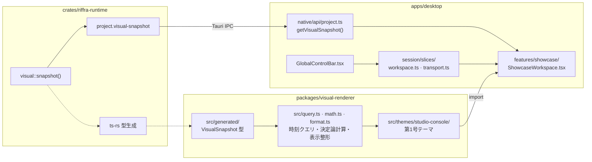

# Showcase レンダラーと Desktop 統合 設計書

`VisualSnapshot` を消費して音楽を可視化する独立レンダラーパッケージ（`@riffra/visual-renderer`）、第 1 号テーマ `studio-console`、および Riffra Desktop への統合を定義する。

全体構想は [showcase-ui.md](showcase-ui.md)、`VisualSnapshot` の生成規則は [visual-snapshot.md](visual-snapshot.md) を参照。

---

## 1. 目的と責務境界

### 1.1 目的

`VisualSnapshot` を時刻 `t` の純粋関数として描画する独立パッケージを用意し、Riffra Desktop での 60fps リアルタイム再生連動と、HyperFrames でのオフライン 1 フレーム撮影を**同一の描画コード・同一のデータ契約**で動かす。

### 1.2 三層の責務境界（単一真実源）

音楽理論・時間軸展開・データ契約の正本はすべて Rust に一本化し、TypeScript 側へドメイン知識や型定義を二重持ちしない。

| 層                                                        | 所有する責務                                                                                                                                                                             | 所有しないもの                                                                                     |
| --------------------------------------------------------- | ---------------------------------------------------------------------------------------------------------------------------------------------------------------------------------------- | -------------------------------------------------------------------------------------------------- |
| **Rust Runtime**<br>(`crates/riffra-runtime/src/visual/`) | 正準状態・Score からの秒展開、和声（`tonesPc` / `chordRole`）、調（`tonicPc` / `scalePcs`）、`top` 判定、トラック分類、ドラムレーン、`VisualSnapshot` の型正本（`ts-rs` で TS 型を生成） | UI レイアウト、色・発光・アニメーション、フレーム補間                                              |
| **独立レンダラー**<br>(`packages/visual-renderer`)        | `VisualTheme` 契約、`VisualSnapshot` の時刻 `t` クエリ（二分探索）、決定論的減衰・補間、表示グリフ整形（`b`/`#` → `♭`/`♯`）、五度圏角度 `(pc * 7) % 12`、`studio-console` 描画           | 音名パース、スケール定義表、同時発音率などの音楽解析、React・Tauri・Desktop 内部モジュールへの依存 |
| **Desktop シェル**<br>(`apps/desktop`)                    | `Edit ↔ Showcase` 切替、`V` / `Space` ショートカット、`project.visual-snapshot` の取得、再生ヘッドの 60fps 秒同期、クリックシークの橋渡し                                                | 音楽構造の解析、Canvas / SVG のテーマ固有描画                                                      |

### 1.3 範囲

- **含めるもの**: `VisualKey` のピッチクラス出力、`project.visual-snapshot` 命令と `ts-rs` 型生成、独立パッケージ `packages/visual-renderer`（基盤＋`studio-console`）、Desktop の `Edit ↔ Showcase` 切替と 60fps 再生連動。
- **含めないもの**: 多トラックの `Overlay / Multi-Lane` 切替・ミニアクティビティチップ・カテゴリ手動上書き、HyperFrames 書き出しフロー、2 号機以降のテーマ、クリーン表示（`H` キー）・16:9 / 9:16 プレビュー枠、既存 `MidiEditorPanel` の書き換え。

---

## 2. 全体データフロー



---

## 3. Rust Runtime と IPC 契約

### 3.1 `VisualKey` へのピッチクラス出力

五度圏のダイアトニック弧と主音ハイライトを TS 側で音名パースやスケール表を持たずに描けるよう、`VisualKey` に Rust 側で解決済みのピッチクラスを含める。

```rust
#[derive(Clone, Debug, Deserialize, Serialize, TS)]
#[serde(rename_all = "camelCase")]
pub struct VisualKey {
    pub tonic: String,
    #[serde(skip_serializing_if = "Option::is_none")]
    pub scale: Option<String>,
    #[serde(skip_serializing_if = "Option::is_none")]
    pub tonic_pc: Option<u8>,
    #[serde(default, skip_serializing_if = "Vec::is_empty")]
    pub scale_pcs: Vec<u8>,
}
```

- `tonic_pc`: `MusicalNoteName::new(&occurrence.tonic).ok().map(MusicalNoteName::pitch_class)`（既存の内部計算をそのままシリアライズする）。
- `scale_pcs`: `tonic_pc` と `occurrence.scale` の両方があるとき、そのスケールの構成音をピッチクラス（`0..11`、昇順・重複なし）へ展開して出力する。
  - Score の既知 12 スケール（`ionian`, `dorian`, `phrygian`, `lydian`, `mixolydian`, `aeolian`, `locrian`, `harmonic_minor`, `melodic_minor`, `major_pentatonic`, `minor_pentatonic`, `whole_tone`）の半音オフセット定義は Rust 側に一元化する（`crates/riffra-runtime/src/score/` のスケール定義と共有し、二重定義しない）。
  - Score のカスタム `scale_definitions` が使われている場合は、`LinkedScore::field(&["scale_definitions", scale_name])` の度数配列を `score::syntax::degree` で半音オフセットへ変換して展開する。
  - `scale` が未指定のときは推測せず `scale_pcs` を空（JSON 省略）とする。
- `design/visual-snapshot.md` の `VisualKey` 記載もこれに合わせる。

### 3.2 Control Command: `project.visual-snapshot`

Desktop がファイル書き出しを経由せず `VisualSnapshot` をインメモリで取得する読み取り専用命令を追加する。

| 箇所                                                                  | 内容                                                                                                                                                                                                                                                                                                                                                                                                                                                                                                                                                                                                                                                                                              |
| --------------------------------------------------------------------- | ------------------------------------------------------------------------------------------------------------------------------------------------------------------------------------------------------------------------------------------------------------------------------------------------------------------------------------------------------------------------------------------------------------------------------------------------------------------------------------------------------------------------------------------------------------------------------------------------------------------------------------------------------------------------------------------------- |
| `crates/riffra-runtime/src/visual/mod.rs`                             | `VisualSnapshot` と配下の型（`VisualTempo`, `VisualMeter`, `VisualBeat`, `VisualSection`, `VisualKey`, `VisualTrack`, `VisualSustain`, `VisualNote`, `VisualDrumLane`, `VisualDrumHit`）および `harmony::VisualChord`, `harmony::ChordRole`, `category::TrackCategory` を `pub` にし、`Clone, Debug, Deserialize, Serialize, TS` を derive する。内部計算用の `#[serde(skip)]` フィールドには `#[ts(skip)]` を付与する。`pub(crate) fn snapshot_optional(session: &CreativeSession) -> Option<VisualSnapshot>` を用意し、`entire_arrangement_end_tick(session) == 0` のとき `None` を返す（`export` は `None` のとき従来どおり `"visual export requires a positive-duration clip"` エラーにする） |
| `crates/riffra-runtime/src/api/table.rs`                              | `project` 群、`ProjectExportVisual` の次に追加:<br>`ProjectVisualSnapshot = "project.visual-snapshot" (EmptyParams) -> VisualSnapshot, project;`                                                                                                                                                                                                                                                                                                                                                                                                                                                                                                                                                  |
| `crates/riffra-runtime/src/api/output.rs`                             | `ControlOutput` に `VisualSnapshot(Option<crate::visual::VisualSnapshot>)` を追加                                                                                                                                                                                                                                                                                                                                                                                                                                                                                                                                                                                                                 |
| `crates/riffra-runtime/src/dispatcher/project.rs` / `host/project.rs` | `ProjectCommand::ProjectVisualSnapshot(_)` で `crate::visual::snapshot_optional(&session)` を呼び、`ControlOutput::VisualSnapshot(...)` を返す                                                                                                                                                                                                                                                                                                                                                                                                                                                                                                                                                    |
| `crates/riffra-runtime/src/api/table.rs`（テスト）                    | `every_command_exposes_a_deterministic_params_schema` のコマンド数を更新                                                                                                                                                                                                                                                                                                                                                                                                                                                                                                                                                                                                                          |

### 3.3 `ts-rs` による単一型生成

`VisualSnapshot` の TypeScript 型を手書きで二重定義しない。

| 箇所                                  | 内容                                                                                                                                                                                               |
| ------------------------------------- | -------------------------------------------------------------------------------------------------------------------------------------------------------------------------------------------------- |
| `apps/desktop/src-tauri/src/types.rs` | 既存の `../src/model/generated` への出力に加え、`../../../packages/visual-renderer/src/generated` へ `VisualSnapshot::export_all(&visual_cfg)` を実行する（`with_large_int("number")` を共通適用） |
| `scripts/gen-barrel.js`               | `apps/desktop/src/model/generated/index.ts` に加え、`packages/visual-renderer/src/generated/index.ts` のバレルファイルも生成する                                                                   |

`VisualSnapshot::export_all` は `VisualSnapshot` が参照する型だけを出力するため、`packages/visual-renderer/src/generated/` には Desktop や Tauri 固有の型は一切混入しない。`npm run gen:types` 1 回で両パッケージの型が常に一致する。

### 3.4 Desktop Native API

| 箇所                                               | 内容                                                                                                                                                   |
| -------------------------------------------------- | ------------------------------------------------------------------------------------------------------------------------------------------------------ |
| `apps/desktop/src/native/api/project.ts`           | `ProjectApi` に `getVisualSnapshot(): Promise<VisualSnapshot \| null>` を追加（`dispatchControl({ command: 'project.visual-snapshot', params: {} })`） |
| `apps/desktop/src/native/preview/preview-api.ts`   | `reads` に `getVisualSnapshot: async () => null` を追加                                                                                                |
| `apps/desktop/src/test/support/fake-native-api.ts` | `getVisualSnapshot: vi.fn(async () => null)` を追加                                                                                                    |

---

## 4. 独立パッケージ `packages/visual-renderer`

### 4.1 パッケージ構成とワークスペース整合

```text
packages/visual-renderer/
├── package.json              # name: "@riffra/visual-renderer", type: "module"
├── tsconfig.json             # strict, ES2023 + DOM, React なし
├── vite.config.ts            # ESM ライブラリビルド設定 + Vitest 設定
└── src/
    ├── generated/            # ts-rs 自動生成（手編集禁止）
    │   ├── VisualSnapshot.ts
    │   └── index.ts
    ├── index.ts              # 公開 API の再エクスポート
    ├── types.ts              # ColorMode, VisualLayout, ViewState, VisualTheme
    ├── format.ts             # 表示グリフ整形（b/# → ♭/♯）、MIDI 音名ラベル
    ├── math.ts               # 決定論的減衰・イージング・最短角度補間・五度圏角度
    ├── query.ts              # 二分探索クエリ、時刻→ステップ変換、非ドラムパルス導出
    ├── themes/
    │   └── studio-console/
    │       ├── index.ts
    │       ├── styles.ts
    │       ├── chord-strip.ts
    │       ├── piano-roll.ts
    │       ├── circle-of-fifths.ts
    │       └── pulse-lane.ts
    └── __tests__/
        ├── format.test.ts
        ├── math.test.ts
        ├── query.test.ts
        └── studio-console.test.ts
```

#### ルート設定との整合

| ファイル                                                                              | 変更内容                                                                                                                                                                                                                                        |
| ------------------------------------------------------------------------------------- | ----------------------------------------------------------------------------------------------------------------------------------------------------------------------------------------------------------------------------------------------- |
| [package.json](file:///C:/svc/runtimes/riffra/package.json)                           | `"workspaces": ["apps/desktop", "packages/*"]`。`lint:ts` の対象に `packages/visual-renderer` を含め、`check` / `typecheck` / `test` で `@riffra/visual-renderer` も検証する                                                                    |
| [apps/desktop/package.json](file:///C:/svc/runtimes/riffra/apps/desktop/package.json) | `dependencies` に `"@riffra/visual-renderer": "*"` を追加                                                                                                                                                                                       |
| [eslint.config.js](file:///C:/svc/runtimes/riffra/eslint.config.js)                   | `packages/visual-renderer/dist` と `packages/visual-renderer/src/generated` を `ignores` に追加。`packages/visual-renderer/src/**` に対して `react` / `react-dom` / `@tauri-apps/*` / `@/*` の import を禁止する `no-restricted-imports` を設定 |
| [knip.json](file:///C:/svc/runtimes/riffra/knip.json)                                 | `packages/visual-renderer/src/generated/**` を無視対象に追加し、workspace 構成が `npm run knip` を通る状態を維持                                                                                                                                |

> [!NOTE]
> `packages/visual-renderer` のスタイルは HyperFrames 単体読み込みでも動作するよう Desktop の `tokens.css` に依存させず、テーマ内のスコープ付き `<style>`（または Shadow DOM）として自己完結させる。Desktop 側の UI クローム（切替バー・Empty State 等）のみが `tokens.css` と [stylelint.config.js](file:///C:/svc/runtimes/riffra/stylelint.config.js) に従う。

### 4.2 公開インターフェース（`types.ts`）

`VisualSnapshot` は `src/generated/` からそのまま re-export する。

```ts
import type { VisualSnapshot } from './generated';

export type ColorMode = 'harmony' | 'velocity' | 'track';
export type VisualLayout = '16:9' | '9:16' | 'free';

export interface ViewState {
  colorMode: ColorMode;
  layout?: VisualLayout;
  /** Desktop 統合時は GlobalControlBar と役割重複を避けるため false にできる。既定 true。 */
  showHeader?: boolean;
  /** ピアノロール等のクリックシークを親へ通知する任意のコールバック。 */
  onSeek?: (timeSec: number) => void;
}

export interface VisualTheme {
  readonly id: string;
  readonly name: string;
  readonly description: string;
  readonly supportedLayouts: readonly VisualLayout[];
  mount(container: HTMLElement, snapshot: VisualSnapshot): void;
  updateSnapshot?(snapshot: VisualSnapshot): void;
  render(snapshot: VisualSnapshot, timeSec: number, state: ViewState): void;
  unmount(): void;
}
```

### 4.3 共通純粋関数（`format.ts`, `math.ts`, `query.ts`）

ドメイン解析ではなく、**描画と時刻参照に必要な純粋関数**だけを置く。

1. **表示整形（`format.ts`）**
   - `formatMusicSymbol(text: string): string`: 表示用に ASCII 臨時記号 `b` / `#` を `♭` / `♯` へ置換する（例: `bVImaj7(#11)` → `♭VImaj7(♯11)`、`Bbmaj7` → `B♭maj7`）。ローマ数字・アルファベット本体を壊さないトークン規則で変換する。
   - `midiToLabel(midi: number): string`: ドラムレーンで `label` が無いときの補助表示（例: `C2`）。

2. **決定論的幾何・減衰（`math.ts`）**
   - **厳守事項**: `Math.random()`、`Date.now()`、`performance.now()`、フレーム間の累積変数、CSS `transition` / `animation` を一切使わない。
   - `circleOfFifthsIndex(pc: number): number`: `(((pc % 12) + 12) % 12 * 7) % 12`（`C = 0` が 12 時、時計回り 30° 刻み）。
   - `circleOfFifthsAngle(pc: number): number`: `-Math.PI / 2 + circleOfFifthsIndex(pc) * (Math.PI / 6)`。
   - `lerpAngle(fromRad: number, toRad: number, t: number): number`: `[-π, π]` への最短角度正規化付き補間。
   - `expDecay(dt: number, rate: number): number`: `dt >= 0 ? Math.exp(-dt * rate) : 0`。
   - `easeOutCubic(t: number): number`: `1 - Math.pow(1 - clamp01(t), 3)`。
   - `stepBounce(dt: number, durationSec = 0.22): number`: ステップ通過時の決定論的バウンス曲線（`0 <= dt < durationSec` で単峰、`それ以外` は `0`）。

3. **時刻クエリとパルス展開（`query.ts`）**
   - すべて昇順配列への二分探索（`O(log N)`）で実装する。
   - `findTempoAt(snapshot, timeSec)` / `findMeterAt(snapshot, timeSec)`: `t <= timeSec` の最後の要素。
   - `findSectionAt(snapshot, timeSec)`: 現在セクションと直前セクション（転調時の角度補間に使用）。
   - `findChordWindow(snapshot, timeSec, count = 4)`: 現在コードを中心にした前後 4 枠、現在インデックス、区間内進行率 `0..1`。
   - `findRecentChordRoots(snapshot, timeSec, maxCount = 4)`: 直近最大 4 コードの `rootPc` 履歴（五度圏の進行軌跡用）。
   - `resolveBeatGridPosition(snapshot, timeSec)`: `beats` と `meters` から任意の時刻 `t` の `{ bar, beat, step, stepsPerBar }` を求める。
     - `stepsPerBar = Math.max(1, Math.round(numerator * (16 / denominator)))`（4/4 で 16、6/8 で 12）。
     - 1 拍あたりの 16 分音符数 `stepsPerBeat = 16 / denominator` を用い、`beats[i].t`〜`beats[i + 1].t` の拍内比率から小節内ステップを算出する（最終拍は直前の拍間隔、または現在テンポから拍長を補う）。
     - 再生カーソルの現在ステップ描画に使うだけでなく、非ドラム曲のパルスレーンでもこの同一関数で各時刻を `(bar, step)` へ写像する。
   - `derivePulseLanes(snapshot)`:
     - `snapshot.drumLanes.length > 0` のとき: `drumLanes` をそのまま使う（表示名は `label`、無ければ該当 Track 名＋`midiToLabel(pitch)`）。
     - `snapshot.drumLanes.length === 0` のとき: 非ドラムトラックから決定論的にパルスレーンを構成する。
       - 非ドラムトラックが **1 本** の場合: `MELODY`（`note.top === true`）／`ACCOMP`（`note.top === false`、存在時のみ）／`PEDAL`（`sustain[].startSec`、存在時のみ）。
       - 非ドラムトラックが **複数本** の場合: `bass` / `chords` / `arp` / `lead` / `vocal` の優先順で最大 4 トラックの発音打点を 1 レーンずつ並べる。

---

## 5. 第 1 号テーマ `studio-console`

> [!IMPORTANT]
> 本セクションは **情報要素・振る舞い・決定論的制約・描画品質** を定義する。**具体的な配色・発光強度・余白比率・線幅・タイポグラフィの細部は固定しない。** 実装者がスタジオ機材調の上質さと「見て気持ちいい」リッチな発光・軌跡表現を追求し、後から実画面を見て細部を調整しやすいよう、ビジュアル定数をテーマ内の一箇所（`styles.ts` / `palette.ts` 等）に集約すること。

### 5.1 必須コンポーネントと振る舞い

1. **ヘッダー（`state.showHeader !== false` のとき）**
   - 曲タイトル、現在セクション名、現在キー（`key` があるとき）、現在 BPM。
2. **コード進行ストリップ**
   - 現在コードを中心に最大 4 枠を表示。
   - `degree` があるときは `formatMusicSymbol(degree)` を主役、`formatMusicSymbol(symbol)` を補足。`degree` が無いときは `formatMusicSymbol(symbol)` を主役。
   - 現在コード枠を強調し、区間内進行率インジケーターを表示。コードが無い曲では崩れない空状態にする。
3. **ピアノロール＋CC64 サブレーン（Canvas 2D）**
   - 再生ヘッドを基準にスクロールする時間窓。
   - 全非ドラムノートの最小〜最大 MIDI に上下余白を足した自動フィット音域（ノートが無ければ C3〜C6 等の既定範囲）。
   - 小節線（強）・拍線（弱）・オクターブ基準線のグリッド。
   - 色分け 3 モード（`harmony` / `velocity` / `track`）の明確な視覚差と簡潔な凡例。
   - **発音演出**: 再生ヘッド通過中のアタック発光（グロウ）、持続中の輝き、通過後の残像をすべて `timeSec` からの純粋関数で描画。
   - **ソロ楽器の主旋律強調**: 非ドラムトラックが 1 本かつ `note.top === false` のノートが存在するとき（Rust 側が計算済みの `top` フラグをそのまま利用）、`top === true` のノートと高ベロシティ音をわずかに明るく・太く描く。
   - **下部サブレーン**: 非ドラムトラックの `sustain` 区間（CC64）を時間軸同期で描画。
   - **クリックシーク**: `state.onSeek` が指定されているとき、クリック X 座標に対応する `timeSec`（`0..durationSec` へクランプ）を通知する。
4. **五度圏（Circle of Fifths）**
   - 12 頂点、`C` を常に 12 時固定（アルファベット表記）。
   - **ダイアトニック弧**: `section.key.scalePcs` が空でないとき、そのピッチクラス群を内側の弧と頂点ハイライトで表現。転調時は直前セクションの `tonicPc` から現在セクションの `tonicPc` へ、`timeSec - section.startSec` に基づく決定論的補間（`lerpAngle` + `easeOutCubic`）で滑らかに回転移動させる。`key` や `scalePcs` が無いときは弧を描かない。
   - **進行軌跡ライン**: 直近 3〜4 コードの `rootPc` 間を結び、新しい線ほど濃く・発光させ、古い線ほど減衰させる。
   - **中央＆下部**: 中央に現在コード、下部に現在キー（あれば）と現在小節番号。
5. **リズム／MIDI パルスレーン**
   - 現在小節のステップグリッド（拍子に応じたステップ数、拍頭に区切り）。
   - `derivePulseLanes` の各レーンを縦に並べ、通常打点と `accent` を区別し、現在ステップ通過時に `stepBounce` で決定論的に弾ませる。

### 5.2 技術品質基準

- **高 DPI**: Canvas は `devicePixelRatio` を適用して鮮明に描く。
- **リサイズ**: `ResizeObserver` でコンテナサイズ変化に追従する。
- **軽量な更新**: 60fps の `render()` 内で DOM ツリーを再生成しない。Canvas は直接再描画、DOM/SVG は `mount()` で生成した要素の属性・テキストのみ更新する。

---

## 6. Riffra Desktop 統合

### 6.1 モード切替とレイアウト

- **Edit モード**: 既存の `AppBodyLayout`（ブラウザー・タイムライン・インスペクター・下部の編集面）をそのまま維持する。
- **Showcase モード**: `GlobalControlBar`・`NoticeBar`・`WorkspaceWait`・`CommandPalette`・`ToastStack` を残したまま、作業領域を全幅の `ShowcaseWorkspace` へ切り替える。
- Audio Engine・Transport は影響を受けないため、**再生を止めずに** `Edit ↔ Showcase` を往復できる。

### 6.2 状態管理

#### `apps/desktop/src/session/slices/workspace.ts`

```ts
export type WorkspaceViewMode = 'edit' | 'showcase';
```

`WorkspaceSlice` に追加（初期値: `viewMode: 'edit'`, `showcaseColorMode: 'harmony'`）:

- `viewMode: WorkspaceViewMode`
- `showcaseColorMode: ColorMode`
- `setViewMode(mode: WorkspaceViewMode): void`
- `toggleViewMode(): void`
- `setShowcaseColorMode(mode: ColorMode): void`

#### `apps/desktop/src/session/slices/transport.ts`

`displayTick` は 250ms スロットリングされるため 60fps 描画には使わない。`TransportSlice` に現在再生位置を秒で返すオンデマンド関数を追加する:

```ts
currentSeconds(timebase: ProjectTimebase): number;
```

- `anchor.playing` が `true`: `ticksToSeconds(anchor.tick, timebase) + (performance.now() - anchor.at) / 1000`
- それ以外: `ticksToSeconds(anchor.tick, timebase)`

これにより、`runtime.ts` と `ShowcaseWorkspace` の `requestAnimationFrame` の順序差による 1 フレーム遅延を防げる。

### 6.3 UI 導線とショートカット

| 箇所                                                                                                                                | 内容                                                                                                                                                                                                                                                                                                                                                                     |
| ----------------------------------------------------------------------------------------------------------------------------------- | ------------------------------------------------------------------------------------------------------------------------------------------------------------------------------------------------------------------------------------------------------------------------------------------------------------------------------------------------------------------------ |
| [apps/desktop/src/app/layout/GlobalControlBar.tsx](file:///C:/svc/runtimes/riffra/apps/desktop/src/app/layout/GlobalControlBar.tsx) | 上部バーに `Edit` / `Showcase` の切替コントロールを追加（`aria-pressed`、ツールチップ `Toggle Showcase (V)`）。Host 未接続・プロジェクト切替中は disabled                                                                                                                                                                                                                |
| [apps/desktop/src/app/AppShell.tsx](file:///C:/svc/runtimes/riffra/apps/desktop/src/app/AppShell.tsx)                               | `viewMode === 'showcase'` のとき `AppBodyLayout` の代わりに `ProjectBoundRegion` 内の `ShowcaseWorkspace` を表示。Command Palette に `Switch to Showcase` / `Switch to Edit` を追加                                                                                                                                                                                      |
| [apps/desktop/src/app/hooks/useAppShortcuts.ts](file:///C:/svc/runtimes/riffra/apps/desktop/src/app/hooks/useAppShortcuts.ts)       | 修飾キーなし `V`（`!event.defaultPrevented && !event.ctrlKey && !event.metaKey && !event.altKey && !event.repeat && !typing`）で `state.workspace.toggleViewMode()` を実行。また `viewMode === 'showcase'` かつ `!event.defaultPrevented && !typing` の `Space` で `state.transport.togglePlayback()` を実行（Showcase 中は `EditorWorkspace` がアンマウントされるため） |

#### PC キーボード演奏との優先順位

`useMusicalTyping` / `useDrumPads` は `window` の **capture phase**（`addEventListener('keydown', ..., true)`）で演奏キーを受け取り `event.preventDefault()` で消費する。`useAppShortcuts` は bubble phase で `event.defaultPrevented` を確認して早期リターンするため、余計な共有状態を増やさずに「演奏キーがショートカットに勝つ」規約（[docs/ui-design.md](file:///C:/svc/runtimes/riffra/docs/ui-design.md) §7）を確実に満たせる。

### 6.4 `ShowcaseWorkspace` の実装

配置: `apps/desktop/src/features/showcase/`

- `ShowcaseWorkspace.tsx`
- `ShowcaseWorkspace.module.css`（Desktop 側クロームのみ。`tokens.css`・Stylelint 準拠）
- `useVisualSnapshot.ts`

#### データ同期とライフサイクル

- **Showcase 表示中のみ** `api.getVisualSnapshot()` を呼ぶ（Edit モード中の編集負荷を増やさない）。
- 再取得トリガー: `hostGeneration`、`activeProjectId`、`canonical.sequence` の変化。
- リクエスト世代番号（またはキャンセルフラグ）で古い応答の反映を防ぐ。
- `snapshot === null` のとき: 空プロジェクト向けの英語 Empty State を表示する（エラー扱いにしない）。
- テーマ制御:
  - 再生中（`transport.status?.state === 'playing'`）: `requestAnimationFrame` ループで毎フレーム `transport.currentSeconds(timebase)` を渡して `theme.render(snapshot, timeSec, viewState)` を呼ぶ。
  - 停止・一時停止中: rAF を止め、`displayTick`・`snapshot`・`showcaseColorMode`・リサイズ変化時のみ 1 フレーム描画する。
  - `onSeek(timeSec)`: `secondsToTicks(timeSec, timebase)` に変換して `transport.seek(tick)` を呼ぶ。

---

## 7. テスト観点と検証

### 7.1 テスト観点

| 層               | 置き場所                                                            | 確かめること                                                                                                                                                                                                                                                                                                |
| ---------------- | ------------------------------------------------------------------- | ----------------------------------------------------------------------------------------------------------------------------------------------------------------------------------------------------------------------------------------------------------------------------------------------------------- |
| Rust Runtime     | `crates/riffra-runtime/src/visual/mod.rs` / `dispatcher/project.rs` | `VisualKey` に既知スケール・カスタム `scale_definitions` の `tonicPc` / `scalePcs` が出力され、スケール未指定時は `scalePcs` が空になること。`project.visual-snapshot` がクリップ有り Project で `Some`、空 Project で `None` を返すこと。`project.export-visual` は空 Project で従来どおりエラーになること |
| レンダラー基盤   | `packages/visual-renderer/src/__tests__/`                           | `formatMusicSymbol` の臨時記号整形、`circleOfFifthsAngle` / `lerpAngle` / `expDecay` / `stepBounce` の境界値、二分探索クエリ（曲頭・曲末・コード空白・転調境界）、4/4・6/8 のステップ変換、非ドラム曲のパルスレーン導出、同一入力での完全決定論性                                                           |
| `studio-console` | `packages/visual-renderer/src/__tests__/studio-console.test.ts`     | `mount` → `render`（複数時刻・色分けモード切替・`key` 欠落・`chords` 空）→ `unmount` が例外なく動き、リスナーが解放されること                                                                                                                                                                               |
| Desktop 統合     | `apps/desktop/src/test/features/showcase/`                          | `GlobalControlBar` ボタンと `V` キーでの `Edit ↔ Showcase` 切替、`Ctrl+V`・入力中・`defaultPrevented` 時は切り替わらないこと、Showcase 中の `Space` 再生トグル、Showcase 表示時のみ `getVisualSnapshot` が呼ばれ `null` で Empty State が出ること                                                           |

### 7.2 検証コマンド

- Rust:
  - `cargo fmt --manifest-path Cargo.toml --all --check`
  - `cargo clippy --manifest-path Cargo.toml -p riffra-runtime --all-targets -- -D warnings`
  - `cargo test --manifest-path Cargo.toml -p riffra-runtime`
- 型生成:
  - `npm run gen:types`
- Renderer パッケージ:
  - `npm run typecheck --workspace @riffra/visual-renderer`
  - `npm run test --workspace @riffra/visual-renderer`
  - `npm run build --workspace @riffra/visual-renderer`
- Desktop / 全体:
  - `npm run check`
  - `npm run lint`
  - `npm run knip`
  - `npx prettier --check <changed files>`
