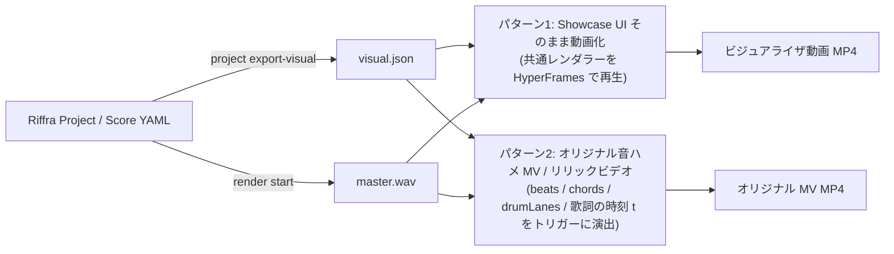

# Riffra Showcase UI & HyperFrames 連携 設計書

本ドキュメントは、Riffra に**おしゃれかつ機能的な音楽可視化 UI（ピアノロール・コード進行・五度圏・ドラム／MIDIシーケンス）**を追加し、さらに **HyperFrames による動画化・MV 制作までシームレスに接続する**ための機能・データ・アーキテクチャ設計書である。

別セッションから実装や詳細設計を引き継げる粒度を目標としている。

---

## 1. 背景と目的

一般的な DAW の UI は編集専用の無骨なツールに留まることが多いが、Riffra は **正準状態に「和声・セクション・歌詞・テンポマップ」を、リンク済みの Score YAML に「主音・スケール・度数表記」を構造データとして持っている** という固有の強みがある。

この強みを活かし、以下の 3 つの価値を同時に実現する UI／データ基盤を作る。

1. **見て気持ちいい音楽体験（Showcase / Visualizer）**
   - 曲の再生に合わせて、ピアノロール・コード進行・五度圏・リズムパルスが美しく連動する。
   - 将来的に複数のビジュアルテーマ（デザインテイスト）を追加・切り替えできる拡張性を持つ。
2. **直感的な作曲レビュー機能（Functional Edit View）**
   - 「メロディが毎小節上がって下がるだけになっていないか」「コードに対してどの音がテンション／経過音か」「転調で重心がどう動いたか」を、視覚的に一発で見抜ける。
3. **HyperFrames とのシームレスな動画・MV 制作基盤**
   - Riffra が吐き出す時刻同期データ（`visual.json`）と決定論レンダラーを共有することで、Riffra で見ていた画面をそのまま高品質 MP4 に書き出せる。
   - さらに UI をそのまま使わなくても、`visual.json` をトリガーにして **音ハメ演出・歌詞アニメーション・転調連動の背景切替** を行うオリジナル MV を HyperFrames で組めるようにする。

---

## 2. 設計原則（守るべきルール）

### 2.1 データと描画の完全分離

- Riffra 本体の状態や Score YAML を描画コードから直接読まない。
- 必ず正規化された中間データ **`VisualSnapshot`（`visual.json`）** を介して描画する。
- これにより、Riffra Desktop UI・複数テーマ・HyperFrames の 3 つが完全に同じデータ契約で動く。

### 2.2 完全決定論的レンダリング（時刻 `t` の純粋関数）

HyperFrames はヘッドレス Chrome で 1 フレームずつ撮影するため、時間経過に依存する状態や乱数があると破綻する。すべての描画は以下の純粋関数として設計する。

```ts
renderFrame(target, snapshot: VisualSnapshot, timeSec: number, viewState: ViewState): void
```

- `Math.random()`、`Date.now()`、フレーム間の累積状態（パーティクルの速度積分や CSS `transition` 頼みのフェード）を使わない。
- ノートの発光減衰や五度圏の軌跡フェードは、すべて **`dt = timeSec - event.startSec`** から数学的な減衰関数（例: `Math.exp(-dt * 4)`）で直接計算する。
- これにより、Riffra 内の 60fps リアルタイム再生でも、シークバーの任意ジャンプでも、HyperFrames のオフライン 1 フレーム撮影でも **1 ピクセルのズレもなく同一の映像** が出る。

### 2.3 名前に頼らない機械的分類

- Score YAML の `role` やトラック名は自由文字列（LLM や人間が曲ごとに自由に付ける）であるため、**文字列一致に依存した振り分けは行わない**。
- 音高分布・同時発音率・音価・歌詞の有無・キット由来といった **音の事実データ** から決定論的に視覚カテゴリを分類し、UI 上で手動上書きできる 2 段構えにする。
- 音源（VST3・内蔵音源）ごとの事情も持ち込まない。音源名・プリセット名・ライブラリのカテゴリ名・特定の音源の鍵盤割り当て（GM ドラムマップなど）は判定に使わない。

### 2.4 音楽表記・ビジュアルの規約

- **コード表記**: ローマ数字のディグリー表記（例: `♭VImaj7(#11)`）を主役とし、アルファベット表記（例: `B♭maj7(#11)`）を補足として併記する。
- **五度圏**: どのキーでも **常に `C` を一番上（12 時位置）に固定** し、各頂点はアルファベット表記とする。
- **余計な説明文を入れない**: 計器・オーディオ機材のように、音楽の構造そのものが語るミニマルな情報設計にする。
- **縦型（9:16）対応時のセーフエリア**: ショート動画用に画面下端付近（UI で隠れる領域）に重要コンテンツを置かない。

---

## 3. UI / UX 設計（Edit ↔ Showcase ワンボタン切替）

### 3.1 モード切替の考え方

「普段の DAW 画面自体をおしゃれかつ機能的にしたい」と「観賞・録画用の綺麗なビューにしたい」の両方を、**ワンボタン（およびショートカット `V`）でのシームレス切替**で満たす。

- **共通基盤**: ピアノロール描画エンジン・再生ヘッド・コード帯は両モードで共有し、**再生を止めずに**レイアウトと情報密度だけを切り替える。
- **Edit モード**:
  - ピアノロールを横幅いっぱいに展開。
  - 和声色／強弱色の切替やコード進行帯を残しつつ、下部サブレーンに **Velocity（ベロシティ棒グラフ）** や編集用コントロールを表示。
- **Showcase モード**:
  - 編集用ツールバーを畳み、**ピアノロール＋五度圏＋コード進行ストリップ＋リズムパルスレーン** を鑑賞・録画向けに美しく配置。
  - 下部サブレーンは **CC64 サステインペダル帯** などの演奏表現表示へ切り替える。
  - **`H` キー（クリーン表示）** で上部操作バーをすべて隠し、画面収録そのままに使えるようにする。

### 3.2 第1号テーマ（`studio-console`）のレイアウト構成

第1号テーマは、コード進行ストリップ＋ピアノロール＋五度圏＋16ステップパルスの構成をベースとする。

> [!IMPORTANT]
> **「第1号だからシンプル／地味に妥協する」わけではない。** 情報構成は整理されたスタジオ機材調をベースにしつつ、**発音時の立体的な発光（グロウ）・残像・五度圏の滑らかな軌跡・色の奥行き・アニメーションの気持ちよさ**まで、最初から「おおっ、綺麗！」と思えるリッチなクオリティで作り込む。

```text
┌─────────────────────────────────────────────────────────────────────────┐
│ ● 曲タイトル  [section · Key · BPM]    [Play] [和声色|強弱|トラック] [Edit|Showcase] │
├──────────────────┬──────────────────┬──────────────────┬────────────────┤
│ Im9              │ IIm7♭5/I         │ ♭VImaj7(#11)     │ V7(♭9)         │
│ Dm9              │ Em7♭5/D          │ B♭maj7(#11)     │ A7(♭9)         │
├───────────────────────────────────────────────┬─────────────────────────┤
│ PIANO ROLL              ■コード音 ■テンション ■経過音 │ CIRCLE OF FIFTHS  C TOP │
│                                               │                         │
│   [ ノート描画エリア ]                        │       ( 五度圏 SVG )    │
│   - 再生バー通過で発光                        │   - 現在キーの弧        │
│   - トラック別「色×形状」または和声色         │   - 直前コードの軌跡線  │
│                                               │   - 中央に現在コード    │
│ ───────────────────────────────────────────── │                         │
│ [ サブレーン: Edit=Velocity / Showcase=CC64 ] │  Key: D minor · Bar 1   │
├───────────────────────────────────────────────┴─────────────────────────┤
│ RHYTHM / MIDI PULSE (16-STEP)                            BAR 1 · BEAT 1 │
│ kick / LH  ■ · · ■ · · ■ · ■ · · · ■ · · ·                              │
│ snare      · · · · ■ · · · · · · · ■ · · ·                              │
│ hat / MEL  ■ · ■ · ■ · ■ · ■ · ■ · ■ · ■ ·                              │
└─────────────────────────────────────────────────────────────────────────┘
```

### 3.3 各ウィジェットの振る舞い

1. **コード進行ストリップ**
   - 現在の小節（またはコード区間）を中心に、直前〜直後の 4 枠をカード表示。
   - 現在のコード枠をアクセントボーダー＋下部インジケーターで強調。
2. **ピアノロール**
   - **色分けモード（3 択）**:
     - `Harmony（和声色）`: 現在コードに対する音の役割（コード音／テンション／経過音・非和声音）で色分け。
     - `Velocity（強弱）`: ベロシティを色の濃淡・明度で表現。
     - `Track（トラック色）`: 多トラック時に楽器ごとのテーマカラーで表示。
   - 再生バーが通過中のノートは、アタック時に強く光り、減衰に合わせて穏やかに光る。
3. **五度圏（Circle of Fifths）**
   - 12 頂点（`C, G, D, A, E, B, F#, Db, Ab, Eb, Bb, F`、`C` を 12 時固定）。
   - **ダイアトニック弧**: 現在のキー（主音＋スケール）に属する 7 音付近を内側の薄い弧でハイライト。**転調した瞬間に弧ごと滑らかに回転移動**する。
   - **進行軌跡ライン**: 直前 3〜4 コードの根音間を線で結び、新しい線ほど濃く・古い線ほど薄く表示する。
4. **リズム／MIDI パルスレーン**
   - 16 分音符グリッドのステップ表示。1 小節のマス数は拍子から決まる（4/4 で 16、6/8 で 12）。
   - ドラムがある曲では、ドラム Track の音高ごとに 1 レーンを並べる。表示名は Score の楽器 ID（`kick` など）を使い、無ければ Track 名と音高から描画側が付ける。音高と打楽器の対応は音源ごとに違うため、Riffra は KICK・SNARE などの種類を決めない。
   - ピアノソロ等の非ドラム曲では「右手旋律／左手リズム／ペダル」などのパルスを表示する。
   - 通常打点とアクセント（高ベロシティ）をサイズ・色で区別し、再生ステップ通過時に縦方向へ軽く弾む。

---

## 4. 多トラック（10〜20トラック）対応と機械的分類

10〜20 トラックの楽曲を 1 枚のピアノロールに同じ塗りつぶしバーで重ねると視認性が崩壊し、逆に「伴奏を全部 15% に薄くする」とアンサンブルの絡み合いが見えなくなる。以下の設計で解決する。

### 4.1 名前・`role` 文字列に依存しない自動分類アルゴリズム

実際に鳴るノート（出力音高・ループ展開後）と構造データから、各トラックを以下の優先順位で機械的に視覚カテゴリ（`category`）へ分類する。判定の厳密な定義は [visual-snapshot.md](visual-snapshot.md) §4.6 にある。

| 優先順 | カテゴリ | 機械的な判定条件（事実ベース）                                                                                                                                      |
| ------ | -------- | ------------------------------------------------------------------------------------------------------------------------------------------------------------------- |
| 1      | `drums`  | Score のキットから作った Track、またはリンク済み Score でドラム文字列などのトリガー演奏だけを鳴らす楽器の Track、またはすべてのノートが MIDI チャンネル 10 の Track |
| 2      | `vocal`  | ノートに `lyric` が存在する                                                                                                                                         |
| 3      | `bass`   | 同時発音率（2音以上同時の打点比率）< 20%、かつ音高中央値 < MIDI 55 (G3) または最低音 < MIDI 43 (G2)                                                                 |
| 4      | `chords` | 同時発音率 >= 30%、かつ平均音価 >= 四分音符                                                                                                                         |
| 5      | `arp`    | 同時発音率 < 25%、かつ平均音価 <= 八分音符                                                                                                                          |
| 6      | `lead`   | 上記以外                                                                                                                                                            |

- Score の `register` や、`comp` / `arps` などの由来は正準状態に残らないため、判定に使わない。
- MIDI チャンネル 10 は、MIDI データの作者が GM の打楽器チャンネルに書いたという事実として使う。受け手の音源がそれをドラムとして鳴らすかは問わない。主に MIDI ファイルを取り込んだ Track に効く。
- GUI・CLI で作った Track は、ノートが既定でチャンネル 1 になり、ドラムであることを示す構造データも無い。これらのドラムは自動では判定せず、手動上書きで指定する。
- **UI での手動オーバーライド**: 自動判定が意図と違う場合（例：ベースが主旋律を弾く曲）、トラック一覧のアイコンを 1 クリックして `lead / chords / arp / bass / drums / hidden` を手動上書きでき、表示設定として保存する。
- **1 トラック全部入り（ソロピアノ等）への配慮**: トラック数が 1 本で同時発音率が高い場合は「ソロ楽器モード」として扱い、同じ時刻に鳴っている **最高音（トップノート、`top`）と強ベロシティ音** をノート単位でわずかに明るく・太く描くことで、自然に主旋律を浮かび上がらせる。

### 4.2 多トラックの 2 つの表示ビュー（切替可能）

1. **Overlay ビュー（色 × 形状で 1 枚に重ねる）**
   - 全部を同じ塗りつぶしバーにせず、カテゴリごとに**線種と質感**を変えることで重なっても潰れないようにする：
     - `vocal` / `lead`: 太めの実線塗りつぶし＋発光（最前面）
     - `chords`: **中抜きアウトラインバー**または細い半透明リボン（中身が透けるため下の旋律を潰さない）
     - `arp`: 短い粒・ダイヤ／ドット風のハイライト
     - `bass`: 低音域にどっしりした太線
     - `drums`: 下部ステップレーンに分離（ピアノロールに混ぜない）
2. **Multi-Lane ビュー（役割ごとに 4〜5 段の横長レーンへスタック）**
   - 15〜20 トラックの大編成向けに、`VOCAL & LEAD` / `KEYS & GUITAR` / `STRINGS & PAD` / `BASS` / `DRUMS` の 4〜5 段へ自動グルーピングして縦積み表示する。
   - 各レーン内でトラックごとに色分けし、どのパートも薄めずにくっきり俯瞰できる。

### 4.3 全トラック・ミニアクティビティチップ

- 画面端（またはピアノロール上部）に全トラック分の小さなカラーチップを並べる。
- 発音中だけチップが明るくなり、20 トラックあっても「今どの楽器が入っているか」が一目で分かる。
- チップにホバー／クリックすると、そのトラックだけを一時的に強調（他を減光）して確認できる。

---

## 5. データ契約：`VisualSnapshot`（`visual.json`）

Riffra の UI と HyperFrames の両方から共通で消費する JSON。型・生成規則・書き出し命令の厳密な定義は [visual-snapshot.md](visual-snapshot.md) にある。

**時間座標はすべて曲頭からの実時間（秒）** で展開済みとし、テンポ変更（`rit.` / `accel.`）や拍子変更の影響をすべて吸収済みの状態にする。

| 項目        | 内容                                                                                                             |
| ----------- | ---------------------------------------------------------------------------------------------------------------- |
| 曲全体      | タイトル、曲の長さ、テンポ変更点（`tempos`）、拍子変更点（`meters`）、拍（`beats`）                              |
| `sections`  | 区間の名前・出現順・範囲。リンク済み Score から主音・スケール（`key`）を補う                                     |
| `chords`    | 重ならないコード列。絶対表記（`symbol`）、度数表記（`degree`）、ルート・ベース・構成音のピッチクラス             |
| `tracks`    | トラックごとの分類（`category`）と、実際に鳴るノート（`chordRole`・`top`・`lyric` 付き）、サステインペダルの区間 |
| `drumLanes` | ドラム Track の音高ごとのレーンと打点（小節・16 分音符位置・アクセント）                                         |

- 度数表記は主音がわかるときだけ出す。Score にリンクしていない Project では `key` と `degree` が無く、コード進行ストリップは絶対表記を、五度圏はキーの弧を省いて描く。キーの推定はしない。
- 五度圏の位置（`C` = 0、`G` = 1 …）は `rootPc` から一意に導けるので、データには持たない。
- 歌詞はノート単位の `lyric` で渡す。正準状態にフレーズの概念が無いため、フレーズ単位の歌詞列は持たない。

### 書き出し

```bash
riffra project export-visual --output ./visual.json
riffra --attach project export-visual --output ./visual.json
```

Riffra Desktop 側ではインメモリで同じ構造体を受け取り、HyperFrames 連携時はこのコマンド（または UI の「HyperFrames 用に書き出し」ボタン）で `visual.json` ＋ 完成 WAV をまとめて出力する。

---

## 6. テーマ拡張アーキテクチャ（`VisualTheme`）

将来的にデザインテイストを増やしてワンボタンで切り替えられるよう、各テーマをプラグイン的なインターフェースとして定義する。

```ts
export interface VisualTheme {
  id: string; // e.g. "studio-console"
  name: string; // 表示名
  description: string;
  supportedLayouts: Array<'16:9' | '9:16' | 'free'>;
  mount(container: HTMLElement, snapshot: VisualSnapshot): void;
  render(snapshot: VisualSnapshot, timeSec: number, state: ViewState): void;
  unmount(): void;
}
```

### 将来のテーマ拡張アイデア

1. **`studio-console`（第1号・ベース）**: 整理されたスタジオ機材調のレイアウトをベースに、発音のグロウ・五度圏の軌跡・色の奥行きまでリッチに作り込んだメインテーマ。ピアノロール＋五度圏＋コード進行＋16ステップパルス。
2. **`sheet-paper`（譜面・エディトリアル調）**: 明るい紙のような背景にインク調の線、五度圏と和声分析が雑誌やスコアのように美しく並ぶライトテーマ。
3. **`neon-pulse`（ビジュアライザ・ライブ調）**: 音圧やベロシティに応じた光彩・波形・空間の奥行き表現を強めた、EDM や電子音楽向けの派手めテーマ。
4. **`hardware-grid`（グルーヴボックス調）**: Teenage Engineering / ステップシーケンサー風の、グリッドとドットが主役のポップな幾何学テーマ。
5. **`piano-waterfall`（鍵盤連動・落下型）**: 画面下部に鍵盤を置き、上からノートが降ってくるピアノソロ特化テーマ（和声色分け＋ペダル発光付き）。

---

## 7. HyperFrames とのシームレス連携設計

`visual.json` と決定論レンダラーを軸に、**2 段階の連携**を実現する。



### パターン 1：Riffra Showcase UI をそのまま動画化

- Riffra の Showcase 描画モジュールを独立した ES モジュール／バンドルとして用意し、HyperFrames の `index.html` から読み込む。
- HyperFrames のタイムライン更新フックから `theme.render(snapshot, currentTimeSec, viewState)` を呼ぶだけで、Riffra でプレビューしたそのままの画面を 1080p / 4K・60fps の MP4 として出力できる。
- 16:9（YouTube 用）と 9:16（YouTube Shorts / TikTok 用、下端セーフエリア確保）を切り替えられる。

### パターン 2：`visual.json` 駆動のオリジナル音ハメ MV / リリックビデオ

- Showcase UI 自体を使わなくても、HyperFrames プロジェクトに `visual.json` を渡すだけで、以下のような高精度な映像演出が簡単に組める：
  - **1 ミリ秒のズレもない音ハメ**: `drumLanes` の打点や `beats` の時刻 `t` を直接参照して、カメラズーム・背景フラッシュ・3D/図形アニメーションを発火（音声解析による誤検出ゼロ）。
  - **完全同期リリックビデオ**: ノートの `lyric` と `startSec`〜`endSec` から、キネティック・タイポグラフィを自動配置。
  - **和声・転調連動のカラーグレーディング**: `sections` の転調や `chords` の緊張度（ドミナント／借用和音など）に応じて、シーンの配色やライティングを自動変化させる。

---

## 8. 段階的実装ロードマップ

一度に全部作らず、動くものを確認しながら段階的に育てる。

- **Phase 1: `VisualSnapshot` (`visual.json`) の生成・エクスポート（Riffra Core / CLI）**
  - 正準セッション＋リンク済み Score の和声・セクション・テンポマップから `visual.json` を決定論的に生成するモジュールと、`project export-visual` 命令を実装。
  - トラック自動分類（`category`）と、ノート単位の `chordRole` / `top` 計算をここに含める。
  - Score 取り込みで作る和声の音名を、主音と度数どおりに綴るよう直す。
  - 設計は [visual-snapshot.md](visual-snapshot.md)。
- **Phase 2: 共通レンダラー基盤＋第 1 号テーマ（`studio-console`）＆ Riffra Desktop 統合**
  - `VisualTheme` インターフェースと `studio-console` を独立パッケージ（純粋 Web モジュール）として実装。
  - Riffra Desktop に `Edit ↔ Showcase` のワンボタン切替（`V` キー）を統合し、再生ヘッドと 60fps 連動させる。
- **Phase 3: 多トラック対応の完成**
  - `Overlay（色×形状）` と `Multi-Lane（役割スタック）` の切替、全トラック・ミニアクティビティチップ、UI からのカテゴリ手動オーバーライドを実装。
- **Phase 4: HyperFrames 連携テンプレート**
  - Riffra からのワンボタン（または CLI）で `visual.json` + WAV を HyperFrames 作品フォルダへ流し込むフローを整備。
  - 「Showcase そのまま書き出しテンプレート」と「`visual.json` 音ハメ・リリック MV ヘルパー」を作成。
- **Phase 5: テーマ拡充＆録画機能強化**
  - 2 号機以降のテーマ（`sheet-paper`, `neon-pulse`, `piano-waterfall` 等）を追加。
  - クリーン表示（`H` キー）、16:9 / 9:16 プレビュー枠切替を追加。

---

## 9. 別セッションから着手する際の確認事項

実際に Riffra リポジトリで実装を始めるセッションでは、最初に以下を確認して詳細を確定させる。

1. **Riffra Desktop のフロントエンド構成確認**
   - 現在のピアノロールやタイムラインが React / Canvas / WebGL 等のどれで組まれているか、再生ヘッド時刻 `t` の購読方法（イベント／ストア／requestAnimationFrame）を確認する。
2. **共通レンダラーの配置とビルド方式**
   - Riffra リポジトリ内の独立パッケージ（例: `packages/visual-renderer`）として管理し、Riffra Desktop からは直接 import、HyperFrames 側からはビルド済み ESM バンドルを読み込む形が自然か検討する。
3. **リアルタイム編集時の再計算コスト**
   - Edit モードでノートを動かしたときに `VisualSnapshot` 全体を作り直すのではなく、編集対象トラックだけ差分更新する仕組みが必要か（数千ノート規模のパフォーマンス確認）。
