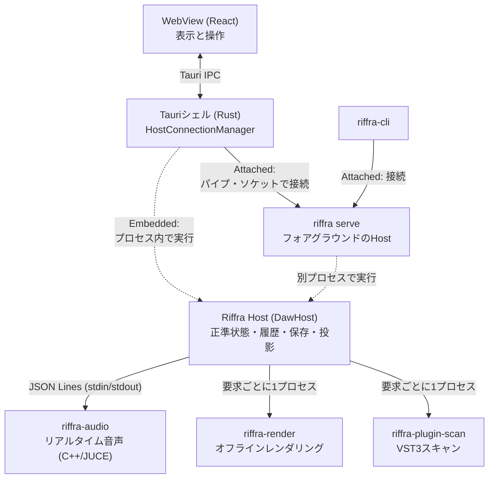
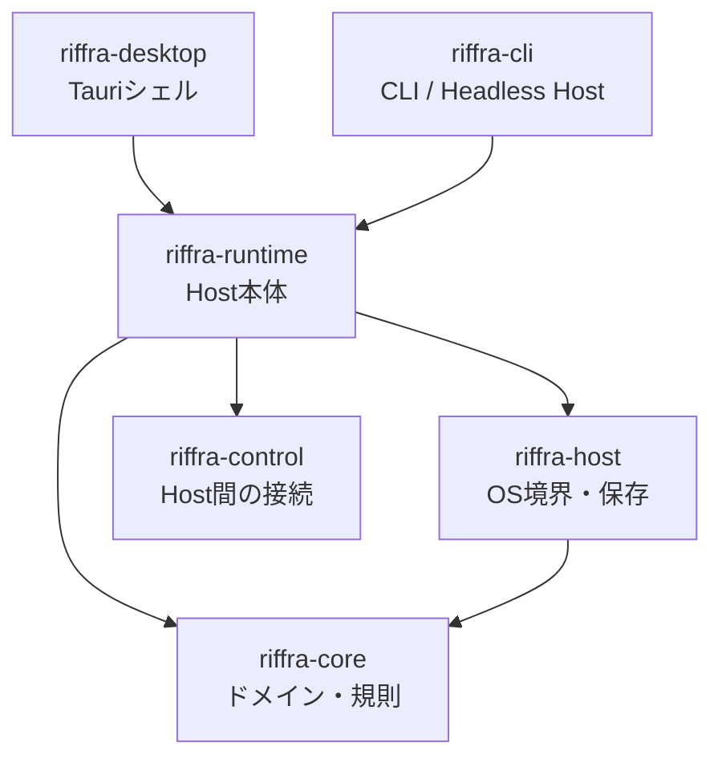
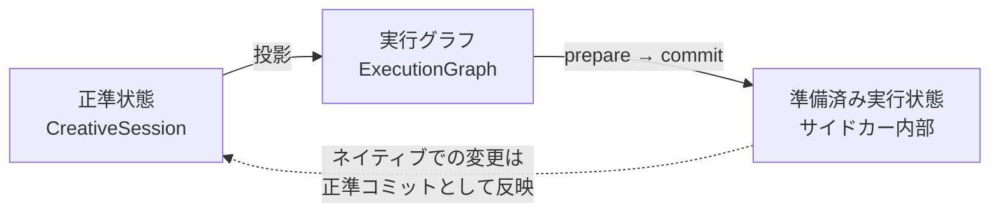
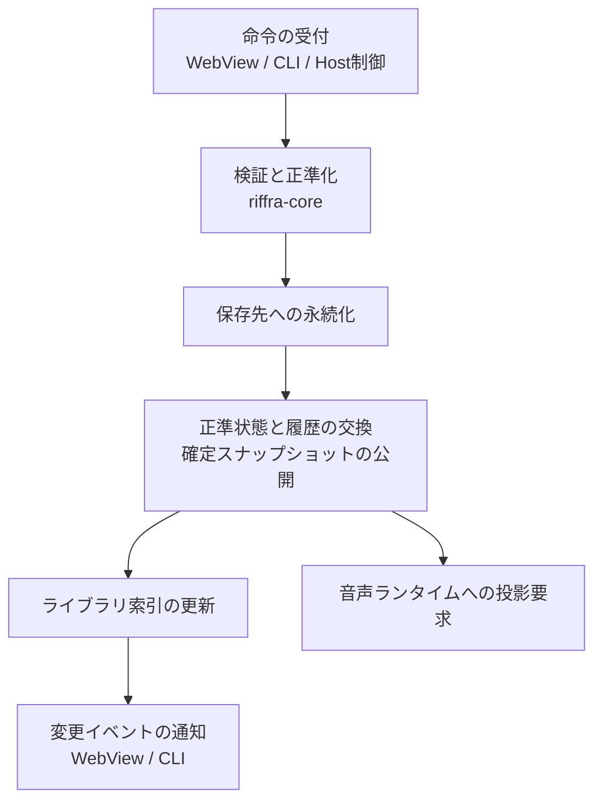
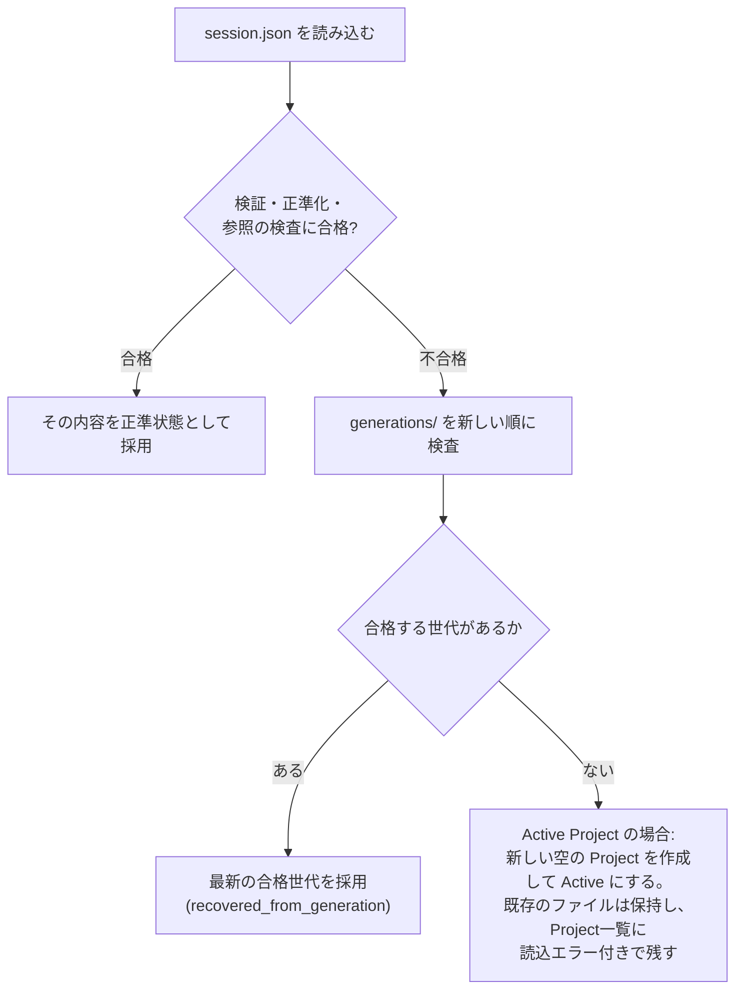

# Riffra アーキテクチャ

Riffraのシステム構造と、すべての制作操作に共通する仕組みを記述する。状態の所有、プロセスの構成、編集の流れ、永続化の保証を定め、機能の設計や変更のときに前提となる土台を提供する。

| 文書                          | 対象                                             |
| ----------------------------- | ------------------------------------------------ |
| CONCEPT.md                    | 製品構想                                         |
| architecture.md(本書)         | システム構造と共通の仕組み                       |
| audio-engine.md               | 音声実行の設計(投影、経路、録音、音源、安全機構) |
| data-model.md                 | 正準モデルのカタログと規則                       |
| ipc.md                        | 境界の契約(命令、イベント、プロトコル)           |
| test-strategy.md              | テスト戦略                                       |
| ui-design.md                  | 画面の設計                                       |
| native/audio-engine/README.md | 音声エンジンのコード構成とビルド                 |

---

## 1. 設計原則

1. **正準状態はRustが所有する。** 永続化される制作状態の正本は CreativeSession である。GUI・CLI・サイドカーはそれぞれの窓口を通じてこの状態を扱い、ネイティブ側で生まれた変更も、Hostの正準コミットを一度経てから制作状態になる
2. **実行状態は正準状態の投影である。** 音声エンジンの実行グラフと準備済みの実行状態は、正準状態から生成する派生物である。投影はいつでも作り直せ、投影が消えても制作状態は残る
3. **GUIとCLIは同じ契約のクライアントである。** 制作操作はControl Commandとして1つの命令表に集約される。デスクトップもCLIも同じ命令を同じHostへ送り、同じ正準状態と履歴を共有する
4. **音声とプラグインは専用プロセスで動く。** リアルタイム音声とプラグインコードはC++のサイドカーが実行する。Hostプロセスは実時間処理から切り離され、サイドカーの障害はHostと独立に回復する
5. **境界の契約は厳格である。** 境界をまたぐデータは必ず検証し、契約からの逸脱は明示的な失敗として扱う。型の正本はRustに置き、TypeScriptはそこから生成し、C++とは契約フィクスチャで整合を保つ
6. **データは手元で完結する。** セッション・素材・ライブラリはすべてローカルディスクに保存し、制作にネットワークは不要である
7. **失敗は明示する。** 検証と保存に成功したものだけが正準状態になる。失敗は原因と影響範囲を構造化した情報として伝え、成功と明確に区別する

---

## 2. プロセスと接続形態

### 2.1 プロセス



| プロセス           | 役割                                                 | 所有する状態                             |
| ------------------ | ---------------------------------------------------- | ---------------------------------------- |
| Tauriシェル        | UI、Hostへの接続、イベントの橋渡し                   | 接続状態、ウィンドウ、ダイアログ         |
| Host               | 正準状態・履歴・保存・投影・ジョブの監督             | DataRootLease、AppCore、Runtime状態      |
| riffra-audio       | リアルタイム音声。デバイス、グラフの実行、録音、MIDI | 準備済み実行状態(投影される一時状態のみ) |
| riffra-render      | オフラインレンダリング                               | 状態を持たない                           |
| riffra-plugin-scan | VST3の列挙と検証                                     | 状態を持たない                           |
| riffra-cli         | 命令の送信。StandaloneではCoreと保存を直接利用       | Standalone時はDataRootLeaseとAppCore     |

リアルタイム音声は常にサイドカーが担う。音声コールバックもプラグインコードもHostプロセスで実行されることはない。

### 2.2 実行モード

RiffraのHostは、正準状態を誰が持つかによって4つの形で動く。

| モード                 | 状態の所有者                       | 要求の経路                 |
| ---------------------- | ---------------------------------- | -------------------------- |
| Standalone(CLI)        | CLI自身のDataRootLease・保存・Core | CoreとHostの部品を直接利用 |
| serve(CLI)             | 起動したHost                       | Host Control Serverを公開  |
| Attached(CLI・Desktop) | 接続先のHost                       | Host Control Serverへ接続  |
| Desktop(Embedded)      | デスクトップ内蔵のHost             | プロセス内でHostへ委ねる   |

- DataRootの所有者は1つのHostに限られる。所有者がいるとき、Standaloneと`serve`は起動に失敗し、Desktopは既存Hostへの接続へ回る
- Attachedは接続先HostのDataRootを借りて使う。保存も正準状態も接続先Hostのものを共有する
- 起動中のHostは自分の存在を `<data_root>/control/host.json` とユーザー単位のRegistryに公開する。Attachedの探索先はRegistryである
- 接続のプロトコルの詳細は ipc.md「境界F」を参照

---

## 3. レイヤーと依存方向

依存は上位から下位への一方向であり、下位層は上位層を知らない。たとえば riffra-core はTauriの存在を知らないため、DesktopとCLIのどちらからも使える。



| クレート       | 責務                                                                                                                                                        |
| -------------- | ----------------------------------------------------------------------------------------------------------------------------------------------------------- |
| riffra-core    | ドメインとアプリケーションの規則。正準モデル(CreativeSession等)、編集の手順、検証と正準化、1 Projectの正準状態と履歴(AppCore)。プラットフォームに依存しない |
| riffra-host    | OS境界。DataRootの所有と排他(DataRootLease)、Projectの保存(SessionStore)、素材の管理、可搬形式(`.riffra`)、WAVとMIDIファイルの読み取り                      |
| riffra-control | 起動中のHostへの接続基盤。Hostの名乗りと接続先情報、一覧(Registry)、パイプ/ソケット上の要求・応答とイベントの流れ                                           |
| riffra-runtime | Host本体。Control Commandの表と実行、正準コミット、実行グラフの投影と調停、サイドカーの起動と通信、録音・レンダー・スキャンのジョブ、ライブラリ索引         |
| riffra-desktop | Tauriシェル。WebViewとHostの接続(Embedded / Attached)、命令の窓口、イベントの橋渡し                                                                         |
| riffra-cli     | Standalone編集、`riffra serve`、Attached接続、対話モード                                                                                                    |

フロントエンドの構成は次の通りである。

| 領域       | 責務                                                                                                                           |
| ---------- | ------------------------------------------------------------------------------------------------------------------------------ |
| `app`      | 起動処理とアプリ全体の組み立て                                                                                                 |
| `features` | 機能ごとの状態・操作・UI・テスト(arrange、audio、browser、instruments、library、mixer、plugins、project、recording、transport) |
| `shared`   | 機能に属さない共通のUI部品                                                                                                     |
| `native`   | ReactとTauriの境界。命令の窓口とテスト用の偽装(FakeNativeApi)                                                                  |
| `model`    | Rustから生成した型(`npm run gen:types`)                                                                                        |

フロントエンドが下位のAPIに触れるのは `native/` 配下に限る。

---

## 4. 状態のモデル

制作状態は3つの層で管理する。上位の層が真実であり、下位の層は上位から生成する。



| 層               | 内容                                            | 正本       | 寿命                         |
| ---------------- | ----------------------------------------------- | ---------- | ---------------------------- |
| 正準状態         | CreativeSession。制作の真実                     | 唯一の正本 | 永続化する                   |
| 実行グラフ       | 正準状態から生成した実行の設計(audio-engine.md) | 正準状態   | いつでも破棄して再構築する   |
| 準備済み実行状態 | サイドカーが実行のために保持する状態            | 実行グラフ | サイドカーの世代と共に消える |

- 下位の層は上位の層を書き換えない。ネイティブ側で生まれた変更は、正準コミットとして上位へ反映する
- 正準状態が変わると、実行グラフと準備済み状態を順に作り直す。逆に下位の層が消えても、制作状態は失われない

---

## 5. 編集のライフサイクル

### 5.1 一つの命令の流れ

制作状態を変更する命令は、すべて同じ順序で確定する。



この順序が保証するものは次の通りである。

- **正準状態が進むのは保存に成功した後である。** 検証や保存に失敗した候補は、正準状態にも履歴にも現れない
- 命令の応答に含まれる確定スナップショットは、その命令自身が確定した状態である
- 通知と投影要求は同じスナップショットから作る。受け手の間で状態がずれることはない

命令の応答・正準状態・保存・イベントの間の整合は、次の3つの観点で捉える。

| 観点     | 意味                                                 |
| -------- | ---------------------------------------------------- |
| 直列化点 | 正準シーケンスが進む瞬間。保存成功後の正準状態の交換 |
| 永続化点 | ディスクに確定する瞬間。アトミックな置換(§6.2)       |
| 可視化点 | 外へ見えるようになる瞬間。確定イベントの通知         |

### 5.2 書き込み権の方針

Project単位の書き込み権で競合を防ぐ。取得する範囲は、守る対象と準備に必要な時間で決める。

| 命令の種類                                 | 方針                                                                                                           |
| ------------------------------------------ | -------------------------------------------------------------------------------------------------------------- |
| 短い命令(読み取りを含む)                   | 受付から後処理の完了まで書き込み権を保持する                                                                   |
| 長い命令(プラグイン読み込みを伴う編集など) | 確定スナップショットで準備し、コミット直前に取得する。準備時とProject ID・シーケンスが一致するときだけ反映する |
| Host全体の命令・Host内部の読み取り         | 確定スナップショットを読み、書き込み権は取得しない                                                             |

- ネイティブのプラグインエディタが生んだ状態の反映、プロジェクト切替時の保留イベントの反映、録音の後処理も、書き込み権を取得して正準コミットとして行う
- コミット後の処理(索引・通知・投影要求)は書き込み権を保持したまま行い、別のコミットが割り込む余地を残さない

### 5.3 イベントの配信

- 通知は接続の世代に紐づく。Host切替の後は、新しいHostのイベントだけが届く
- メーターや再生位置のような高頻度の値は正準状態と切り離し、独立したイベントで配信する
- 正準状態の変更イベントはCoreの確定順序どおりに届く。受け手が順序を組み立て直す必要はない

---

## 6. 永続化と回復

### 6.1 ディスクの構成

```text
<data_root>/
├─ workspace.json            # Active Project の識別
├─ .riffra.lock              # DataRoot の排他所有
├─ projects/<project-id>/    # Project container(UUID)
│  ├─ session.json           # 現行の CreativeSession
│  └─ generations/           # 世代スナップショット
├─ library/riffra.db         # ライブラリ索引(SQLite 読み取りモデル)
├─ recordings/               # 録音テイク(inbox / archive / library)
├─ assets/imports/           # 取り込んだ素材
└─ renders/                  # レンダリング出力
```

- ProjectはDataRoot内の制作単位であり、`session.json` に正準状態を保持する。Desktopの既定のDataRootはユーザーの `Music/Riffra` 配下である
- `.riffra` はProjectの持ち出し用パッケージであり、Import / Exportでのみ扱う。正準そのものではない
- レンダリング結果は `renders/` へ保存し、正準状態やパッケージには含めない

### 6.2 保存の保証

- 保存はアトミックである。クラッシュ後も `session.json` は「完全な旧内容か完全な新内容」のどちらか一方として読める
- 保存の前に世代ファイルへ現在の内容を残す。これが手動・自動の回復の材料になる
- 保存の前にProject領域の空き容量を検証し、不足時は保存を拒否する
- 正準状態は保存に成功した後に進む。ディスク上の内容が正準状態に追いつかないことはない(§5.1)

### 6.3 読み込みと回復

読み込みでは、検証と正準化に合格したものだけを採用する。



- 破損した `session.json` は上書きしない。唯一の回復手段であるためである
- 世代からの復元は、利用者が選択した世代を検証の上で正準状態として復元する。検証に合格した世代だけが採用の対象になる

### 6.4 参照の整合

- セッションが参照するアセットIDは、すべて登録済みである。未登録のIDを含むセッションは保存・読み込みともに採用されない
- 参照先のファイルが見つからない素材は欠落(Missing)として列挙され、制作は続行できる

### 6.5 取り込みと書き出し

- `.riffra` のImportは、既存のProjectを上書きせず、新しいProjectとして追加する
- Sonalloy Bundleの取り込みは、検証(Manifest・ファイル一覧・ハッシュ・参照先)→ 新規Projectの作成とリソースの保存 → Runtimeの準備 → 切替、の順で進める。途中で失敗したときは新しく作ったものを取り除き、既存のProjectと履歴は元のままである
- 取り込んだProjectは元のBundleを参照せず、音源定義とアセットをProject自身が所有する

### 6.6 セッション文書の版

- セッション文書は版(`schemaVersion`)を持ち、読み込みでは版を先に確認する。現行の版だけを採用する
- 旧版のための互換分岐や自動変換は用意せず、版を上げるときは明示的な変換の経路を検討する

---

## 7. 横断機構

### 7.1 セーフモード

サイドカーの起動・デバイスアクセス・プラグイン読み込みを省略して起動する診断モードである。

- 起動方法は `--safe-mode` フラグまたは `RIFFRA_SAFE_MODE` 環境変数である。判定はこの明示だけで行う
- 初期化は「セッション読み込み + ライブラリ索引」だけで完了する
- 音声・録音・再生・プレビュー・VST3読み込み系の命令は明示的なエラーを返す。オフライン解析・書き出し・ライブラリ操作は通常モードと同じに使える
- 目的は外部デバイスやプラグインが原因のハングの切り分けであり、データの読み書きは通常モードと同一である

### 7.2 ライブラリ索引

ライブラリはSQLiteの**読み取りモデル**であり、正準状態は常にセッションとアセットである。

- 素材・録音・セッション内容の検索と一覧のための眺めを提供する
- 正準コミットごとに索引を同期更新する。更新に失敗しても制作状態には影響しない
- お気に入り・カテゴリ上書き・ユーザータグなどの利用者の設定は索引側に保存し、Projectの正準シーケンスには含めない
- UIの検索と一覧の読み先はこのモデルに統一する

### 7.3 バックグラウンドジョブ

VST3スキャンとオフラインレンダリングはジョブとして管理する。

- ジョブの種別が結果の形を決める。状態は `queued → running → cancelling → cancelled / completed / failed` で進み、終端から戻らない
- 進捗とメッセージをUIへ配信し、IDで照会・キャンセルできる
- レンダリングの実行の設計は audio-engine.md「オフラインレンダリング」を、スキャンの意味は audio-engine.md「カタログと解決」を参照

---

## 8. フロントエンドの責務

- フロントエンドは CreativeSession を描画し、利用者の操作を命令へ変換する。応答はCoreの確定順序どおりに適用する
- 競合の解決・部分マージ・命令の待ち行列はCore / Host側に集約する。フロントエンドは応答を画面へ反映することに専念する
- 選択・パネル幅・ズーム・ダイアログは表示状態であり、正準状態とは別に管理する
- Undo / Redoの可否はCoreが返す履歴状態を表示する。投影の構築や再試行はHostのRuntimeへ委ねる
