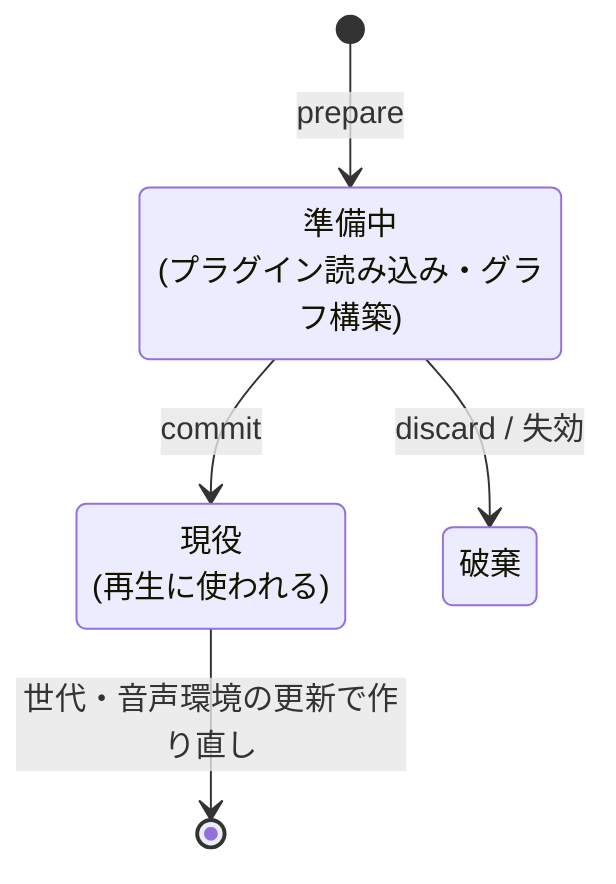
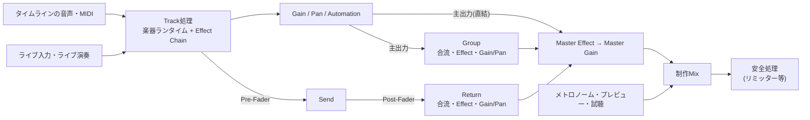
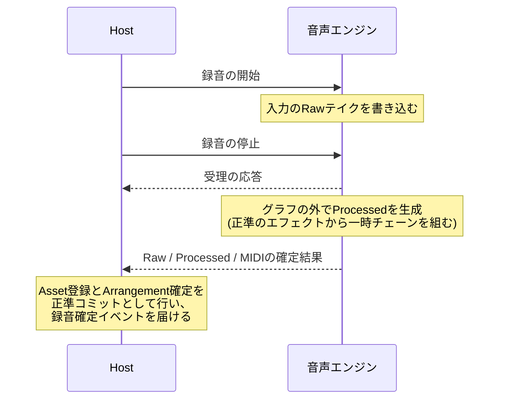
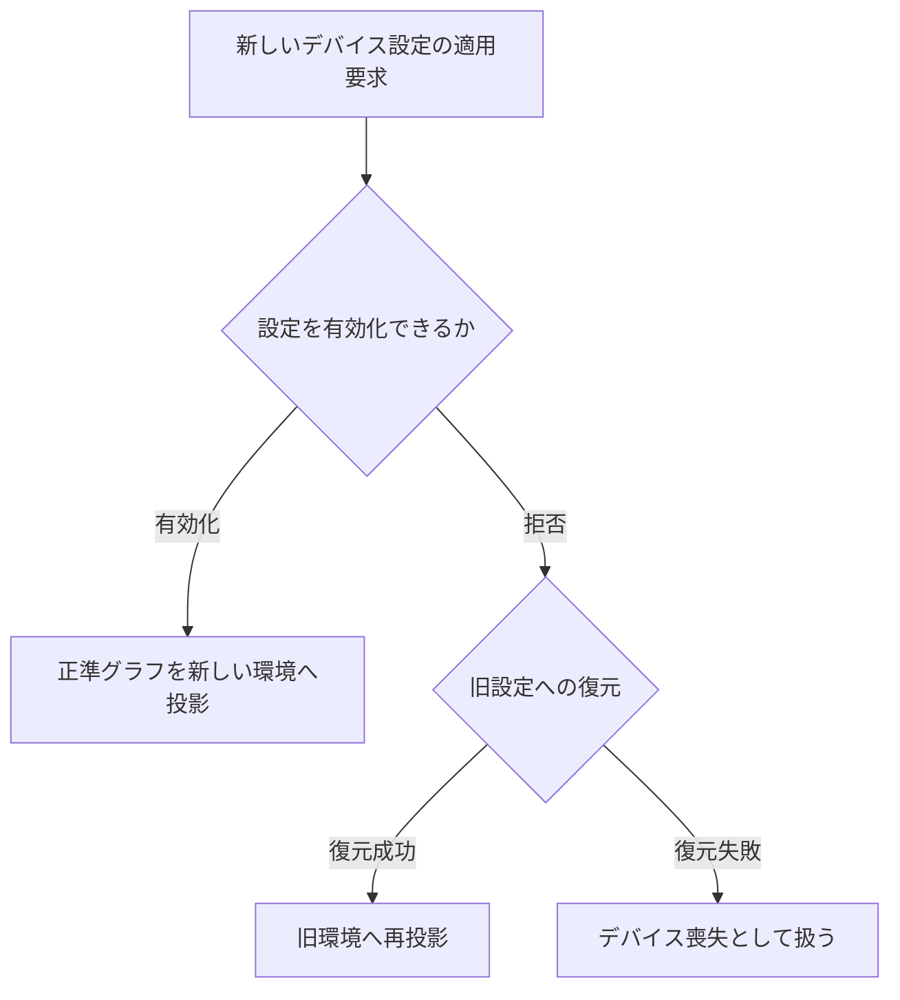

# Riffra 音声エンジンの設計

正準状態がどのように音として実行されるかを記述する。Rustが決めた制作状態を、C++の音声エンジン(サイドカー)がどのように実行するか、その設計を対象にする。正準モデルの定義は data-model.md、境界プロトコルの形式は ipc.md、システム全体の構造は architecture.md が担う。

すべての機構に共通する前提を先に述べる。

1. **正準状態だけが真実である。** 実行グラフは正準状態から作る投影であり、いつでも作り直せる
2. **ネイティブ側で生まれた変更は、Hostの正準コミットを経て制作状態になる。** プラグインエディタでの操作も同じ経路を通る
3. **音声コールバックは事前に準備された状態だけを参照する。** 確保も待機も、準備の段階で終えておく

---

## 1. 実行グラフへの投影

### 1.1 実行グラフ

実行グラフ(ExecutionGraph)は、ある時点の正準状態を音声エンジンが実行できる形に変換したものである。トラック、ルーティング、デバイスとその状態、オートメーションレーン、テンポと拍子、マスターゲインを含む。

- 型は riffra-runtime が所有し、リアルタイム再生とオフラインレンダリングが同じ契約を使う
- ドメイン層(riffra-core)の世界に実行グラフは登場しない。正準状態を実行グラフへ変換するのはHostの仕事である
- 変換は二段階で進む。まず素材・プラグイン・内蔵プリセットをファイルシステムから解決し、次に解決済みの資源からグラフを組み立てる。組み立ては副作用のない計算である
- 実行できない素材・デバイス・レーンはグラフの対象から外し、診断として記録する。正準状態のデータはそのまま残る

### 1.2 グラフの入れ替え

編集のたびに音声を止めないため、グラフの入れ替えは事前準備と昇格の二段階で行う。

| 操作    | 意味                                                                                                     |
| ------- | -------------------------------------------------------------------------------------------------------- |
| prepare | 新しいグラフをサイドカーの中で事前構築する。プラグインの読み込みを含む。この時点ではまだ再生に使われない |
| commit  | 準備が済んだグラフを現役グラフとして昇格させる                                                           |
| discard | 準備したグラフを破棄する                                                                                 |

準備の間も現役グラフは鳴り続ける。編集が音を途切れさせることはない。

どのグラフを採用するかはHost側の調停役が判断する。

- 投影要求は、正準状態のシーケンス、アレンジのリビジョン、サイドカーの世代、音声環境のリビジョンの組み合わせで識別する
- 新しい要求は後から来たものを優先し、待機中だった要求には失効を伝える
- 準備が失敗したときも現役グラフは維持され、再生は続く
- サイドカーの再起動や音声環境の変更に合わせて、最新の正準状態から投影し直す
- 内容が同じグラフがすでに現役で動いているときは、それを使い続ける。表示だけの変更で音が作り直されることはない

### 1.3 トランスポート

再生と停止の要求は、投影の状態と合わせて判断する。

| 状況           | 動作                                                                                             |
| -------------- | ------------------------------------------------------------------------------------------------ |
| Play(準備済み) | 直ちに再生を始める                                                                               |
| Play(準備中)   | starting を表示し、投影の完了を待つ                                                              |
| Pause          | 短いフェードで無音にし、再生位置と有効な値を保持する                                             |
| Play(Paused)   | 保持した位置から再開し、オートメーションを評価し直す                                             |
| Stop           | 保留中のPlayに優先する。その後の準備完了で再生が始まるのは、利用者の明示的な要求のときだけである |
| 投影失敗       | Playの意図を解除する。再試行は利用者の明示的な操作でのみ行う                                     |

デバイスの状態、グラフの投影状態、トランスポートの状態は、それぞれ独立したイベントとして通知する。

---

## 2. 音声経路とミックス

### 2.1 経路の構造

- 楽器トラックでは、タイムライン上のMIDIとライブ演奏のMIDIが同じ楽器ランタイムへ合流する。ライブ入力のための専用の音源や経路は設けていない
- 音声トラックでは、タイムライン上の音声と監視中の入力が同じエフェクト列を一度だけ通る
- GroupとReturnは音声の合流・エフェクト・ミックスを担う。音源・MIDI・録音の処理はGroup / Returnの役割には含まれない
- MasterゲインはSessionSettingsが保持し、Masterエフェクトの後に一度だけ適用する
- メトロノーム・プレビュー・プラグイン試聴は制作Mixの後で合成し、安全のための処理は最終出力に置く

### 2.2 Sidechain送信

SidechainSendは、トラックの信号を指定したEffect Deviceの補助入力へ分岐する経路である。

- 分岐位置は `preFader` と `postFader` から選ぶ。Pre-FaderはTrackのEffect後、Post-FaderはGain・Pan適用後の信号である
- 宛先はTrack・Group・Return・Master上のEffect Deviceの最初の補助入力である。Mono入力には左右を合成して渡し、Stereo入力には左右を保持する
- 複数の送信はDeviceごとに合流する。Deviceの主出力だけが後続のEffectへ渡る
- VST3の実バス能力からレイアウトを検証する。接続先を変更するときは補助入力の構成を含めて再準備し、対応しない接続は準備エラーになる。Missing Pluginの接続は正準状態に保持したまま、実行診断へ残る

処理順序と補償は次の通りである。

- External AudioとSidechainの依存関係を合わせてTrackの処理順序を決め、同じ段階の独立Trackを並列に処理する
- 各送信先Deviceの主入力と補助入力の累積遅延を比較して補償を配置し、そのDevice以降の遅延へ反映する。補助入力はTrack処理の後にGroup・Returnを経由し、最後にMasterへ渡る
- Sidechainの送信元と、トラック上でSidechainを受けるトラックは、低遅延監視の迂回対象から外れる

Mute・Soloとの関係は次の通りである。

- SidechainはSoloによる主出力の分離の後も維持される。無音になるのは、送信元TrackのMuteまたは送信の無効化のときである
- GroupのMuteはTrackからのSidechainを止めない。宛先EffectのBypassでも接続は保持される
- Seek・Loop・Stop・グラフの切替では補助入力と補償用バッファをリセットし、直前の処理区間の信号を持ち越さない

### 2.3 MuteとSolo

MuteとSoloは、主出力と並列Sendの可聴経路を決める。

| 操作        | 可聴経路                                                             |
| ----------- | -------------------------------------------------------------------- |
| Track Mute  | 主出力と、そのTrackの全Sendを止める                                  |
| Group Mute  | GroupからMasterへの出力を止める。Groupへ入る前のTrack Sendは維持する |
| Return Mute | そのReturnのMaster向け出力を止める                                   |
| Track Solo  | そのTrackの主出力、所属Group、そのTrack由来のSendを通す              |
| Group Solo  | 所属Trackの主出力とGroup出力を通す                                   |
| Return Solo | そのReturnへのSendとWet出力を通し、Dry主出力を抑制する               |

複数のSoloは加算し、Muteを優先する。

### 2.4 ミキサーの一時値

フェーダーやパンを動かしている最中の値は、現役グラフへ直接適用される。

- 一時値は音声処理の中で直接読まれる。保存・履歴・投影の入力になるのは確定後の値である
- 確定の操作で、正準状態への編集として一度だけ反映する
- 無効なSendは正準値だけを更新し、有効化したときにグラフへ反映する
- Masterゲインの一時値は、次のグラフの公開で正準値に戻る
- サイドカーの再起動や音声環境の変更では、最新の正準状態からミキサー全体を復元する

---

## 3. 遅延補償

エフェクトや経路ごとの遅れを揃えるための補償(PDC)を、接続に配置する。

- 入力の累積レイテンシを合流先ごとに比較し、遅い側へ揃える。Masterエフェクトのレイテンシも含める
- 補償に必要なバッファはグラフの準備時に確保する。音声コールバックの中で調整する処理は含まれない
- 外部音声は複数の入力元を持ち、ミックス後の信号を遅延補正して合算する。供給関係はグラフ準備時に確定し、依存しないトラックは並列に処理する

**低遅延監視**は、演奏の応答性を優先するための迂回である。

- 楽器トラックへのライブ演奏では、経路の補償遅延を迂回し、タイムライン上の素材だけを同じ量だけ遅らせて両者の同期を保つ
- 次の構成では通常の補償を適用する。他トラックへの音声供給、外部音声の入力、有効なSend、音量・パンのオートメーションを持つトラック、Sidechainの送信元と受信先である
- オフラインレンダリングでは常に通常の補償を適用する

---

## 4. オートメーション

正準状態のオートメーションレーンを唯一の情報源とし、実行グラフ経由でサイドカーへ渡す。Lane や Point の編集用 ID は音声処理へ送らない。

| 項目               | 方針                                                                                                                                                                                                                           |
| ------------------ | ------------------------------------------------------------------------------------------------------------------------------------------------------------------------------------------------------------------------------ |
| 補間               | linear は対象ごとの単位で補間する(ゲインはdB、パンは左右位置、デバイスパラメータは正規化値)。step は次の点の時刻まで前の値を保持する。最初の点の前と最後の点の後は端点の値。linearAmplitude は境界から指定秒数で振幅を補間する |
| 適用位置           | ミキサーの値(フェーダー・パン・センド)はサンプル単位。VST3パラメータはブロック先頭の位置                                                                                                                                       |
| 識別               | VST3の安定パラメータIDを使う。インデックスや名前は識別に使わない                                                                                                                                                               |
| 実行できないレーン | 正準状態に残し、実行から外して診断に記録する。レンダリング結果にも警告を残す                                                                                                                                                   |

編集と再生の関係は次の通りである。

- ポインタで連続編集している間の値は、準備済みグラフへの一時的な上書きとして扱う。正準状態・履歴・保存状態が変わるのは、確定操作で一度だけ反映されたときである。キャンセルやプロジェクト切替があれば上書きを手放す
- Automation Readが有効な間は、デバイスパラメータ・プリセット・状態の手動変更を拒否する
- 再生中はレーンの値を優先し、停止後はデバイスの静的な値に戻る
- レーン編集では既存のプラグインインスタンスをそのまま使い続ける

---

## 5. MIDIとライブ入力

- タイムラインのMIDIは投影時に時系列へ整列し、再生時は再生位置の近傍だけを取り出す。ループは同じスケジューラが処理し、境界をまたぐノートの対応もそこで合わせる
- ライブMIDIは固定容量のキューで受け、あふれたメッセージは破棄して診断に数える。音声の実時間を優先する
- 音声トラックの入力監視の可否は、モニタリング設定から投影時に決める。楽器トラックの低遅延監視は演奏中に変わるため、サイドカーが判断する
- ライブ演奏の対象トラックはランタイムだけが知る状態であり、正準状態の保存対象には含まれない

---

## 6. 録音の実行

録音は二段階で確定する。

1. **録音中** — 入力の原音(Raw)だけを書き込む。録音のためにエフェクトを通した処理を常設することはない。Sidechainを受けるトラックでは、Deviceへ届いた補助入力もRawと同じキャプチャ窓で保存する。ライターとバッファは録音開始前に用意し、ファイル書き込みは専用スレッドが行う
2. **停止後** — 正準のトラックエフェクトから一時的なチェーンを組み、ブロック単位で加工音(Processed)を生成する。生成はグラフの外で行い、作業バッファは録音時間に比例して増えない

Processedの生成では、保存した補助入力と主入力の補償設定を使い、Rawと同じファイル内区間で再生する。ライブ入力やループの各周回も録音時の制御信号を再利用できる。制御信号が欠損・不完全なときはそのトラックのProcessed生成を省略し、理由をマニフェストへ記録してRawのみを完成したテイクとして保持する。

保証することは次の通りである。

- カウントイン中の停止は録音を取り消す
- 停止処理は必ず完了する。失敗した場合はRawの有無に応じて recoverable か failed に確定してから通知する。途中状態で終わることはない
- 加工音の生成中は、新しい録音とプロジェクトの切替を受け付けない

確定後のアセット登録とアレンジへの反映は、Hostの正準コミットとして行われる(architecture.md「編集のライフサイクル」)。録音の正準モデルとテイクの構成は data-model.md「録音」を参照。

---

## 7. 音源とプラグイン

### 7.1 実行の単位と寿命

- 内蔵音源(Sonalloy)とVST3は同じ楽器ランタイムの抽象で実行する。リアルタイム再生とオフラインレンダリングで同じ経路を使う
- 構成と保存状態が一致するデバイスは、グラフを入れ替えても同じ実行単位を共有する。軽い変更は既存のインスタンスのままで反映する
- プラグインの生成・破棄・状態の適用は制御側で行う。音声コールバックの中でライフサイクル操作が行われることはない
- サードパーティの処理は期限付きで直列化する。期限を過ぎた処理は開始せず、ハングしたプラグインからも回復できる

### 7.2 パラメータと状態

- VST3の安定パラメータIDはグラフ準備時に実パラメータへ解決する。解決できないレーンは実行から外し、診断へ記録する
- 正準状態がプラグイン状態の正本である。再生中の一時的な値が静的な状態へ保存されることはない
- 保存済みのプラグイン状態は、音源の割り当てと同じ正準コミットへ取り込める。保存形式と対象の一致をRustが検証し、実体への適用はコミット後の投影で行う
- エディタでの操作はHostが正準コミットとして反映する。正準状態と内容が異なるときだけ確定し、表示用の情報だけの通知は保存対象から外れる
- パラメータ値は正規化値とプラグインの表示文字列の両方を扱える。表示文字列からの変換はHostがプラグインに問い合わせて行い、正準状態には数値だけを保存する。変換できない文字列は値0として適用せず、失敗として扱う
- パラメータの設定と読み取りは、直前の正準変更の投影が音声エンジンへ確定したうえで実行する。設定の成功は、読み戻した実行状態が要求と等価であることまで確認してから返す。不一致の検出は、正規の同期で実効値が通知される範囲に限る
- パラメータ設定の応答は、対象と、設定によって名前・表示値・値が変わったほかのパラメータの読み戻し値を返す
- プラグインのレイテンシが変わったときは、次の投影の遅延補償に反映する

### 7.3 カタログと解決

- VST3の列挙と検証はスキャン専用のプロセスで行い、結果をカタログとして保持する
- 正準状態は解決済みの実パスを保持する。カタログの内容で正準状態を自動補完することはない
- カタログIDからの解決は、現在のDataRootで一意に照合し、役割と実パスの存在を検証する。検証に失敗した要求は拒否される

### 7.4 試聴

プラグイン試聴は、プロジェクトの外でプラグインを読み込み、そのエディタを開く機能である。

- 音源ならライブMIDIをトラックより先に受け、エフェクトなら選択中の音声入力を処理する
- 出力はアレンジの後に加算し、入力監視と同じくフィードバック保護の対象になる
- エディタを閉じると破棄され、その状態はプロジェクトに入らない

---

## 8. デバイスと安全

### 8.1 デバイスの切替

デバイスの有効化とグラフの投影は別の操作として扱う。

- 有効化の後に投影へ失敗した場合は、デバイスを元に戻さず、投影失敗を報告する
- 要求されていない設定への置き換えは行わない

### 8.2 安全ミュート

サイドカーは出力を止める理由ごとに独立したミュートを持ち、各所有者は自分のミュートだけを解除できる。

| 所有者             | かかる場面             | 解除                                                     |
| ------------------ | ---------------------- | -------------------------------------------------------- |
| ユーザー緊急       | 利用者の操作           | 利用者の操作                                             |
| エンジン遷移       | 起動中・デバイス切替中 | デバイスと正準グラフが揃った後。解除時にフェードインする |
| デバイス障害       | デバイスの喪失         | 復旧後                                                   |
| フィードバック保護 | 監視中のハウリング検知 | 安全確認の上での明示的なリセット                         |

Rustが保持するのは利用者の緊急ミュートの意図だけで、ミュート状態の正本はサイドカーにある。

### 8.3 メーターと診断

メーターと診断値は正準状態と切り離して扱う。制作状態と測定値を混ぜないためである。

- メーターは投影と一致するプロジェクト・世代の値だけを転送し、表示用の専用の保持場所で更新する。正準状態や音声状態のイベントへ複製されることはない
- 音声の診断値(コールバックの超過、処理時間、リミッターの動作量、ライブMIDIの破棄数など)は、同じ世代の音声処理の状態を確認するための値である。障害の予測材料ではない
- 実行できない素材・デバイス・レーンの診断はRustが保持し、投影状態のイベントで通知する

---

## 9. オフラインレンダリング

リアルタイム再生と同じ実行グラフ、同じミックス経路を使う。

- プラグインを使う書き出しでは、本番処理の前に設定された準備時間だけ無音を流し、プラグインをリセットしてから書き出す。準備時間は読み込みや合成に時間のかかるプラグインに合わせて調整できる
- リアルタイムの速さに縛られず、指定されたテールとグローバルフェードを適用して書き出す。再生操作用の開始・停止フェードは書き出しには適用しない
- 書き出し時、入力されたMixdown設定が正準設定と異なるときだけ設定を確定し、その結果を受け取ってからRender Jobを開始する。同じ設定での書き出しは正準状態をそのまま維持する
- ステムはMixと同じ時間範囲・サンプルレート・フレーム数で書き出す。External Audioと有効なSidechainの送信元、およびそのExternal Audio依存元の処理は維持し、他トラックの主出力とReturn向けSendは混ぜない。Sidechainは指定Deviceの補助入力だけへ渡す。センドや共有経路の遅延補償は維持する。非線形エフェクトがある場合、ステムの合計と全体ミックスの厳密な一致は保証の対象外である
- 測定(ラウドネス・ピーク)は完成したファイルに対して行い、音声グラフの再実行は伴わない。測定できないことをゼロで埋めず、通常の書き出しの成功とも失敗とも区別する。マスタリングを要求したジョブで測定器が使えない場合はジョブを失敗させる。ラウドネスの調整は一定の入力ゲインと4倍オーバーサンプリングのピークリミッターを組み合わせる。完成候補を測定し、必要なら出力ゲインを補正してから入力ゲインを再調整する。最大8回で目標ラウドネスとの差が0.5 LUFS以内かつTrue Peakが上限以下になった候補だけを採用し、到達できなければジョブを失敗させる。LRA目標は任意の測定・警告条件であり、ダイナミクス調整には使用しない
- 通常Renderと各StemではMarkerの区間ごとにもラウドネス・True Peak・帯域レベルを測定する。境界は書き出し時点の正準状態のMarkerとTimebaseで決まり、最後の区間にはTailを含める。True Peakの100msフレームは補正後の開始位置が属する半開区間に割り当て、末尾のサンプルまで解析に含めるためFFmpeg入力だけを無音で延長する。全体と区間のラウドネスは独立した測定状態を返す。区間測定が失敗しても完成WAVと測定済みの帯域値を保持し、測定不能の理由を返す。無音や有効なブロックのない区間は正常な測定結果として値をnullにする。保存済みWAVの `analysis.measure` も同じ計算を用い、任意の重複する秒数区間を測定できる。解析は楽曲や保存済みの測定値を変更しない。解析中の管理対象Renderは削除できない
- 素材やMIDI音源を解決できない場合はジョブを失敗させる。欠落したエフェクトはチェーンから外して残りを処理し、除外したデバイスを結果の警告へ残す
