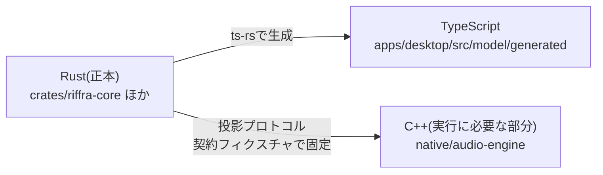
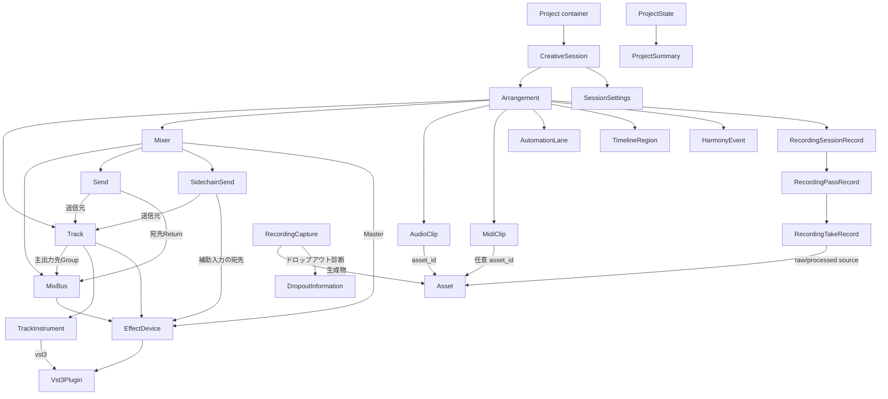

# Riffra データモデル

Riffraの制作状態を構成するエンティティのカタログと、それらが従う規則を記述する。正準定義はRustのコードにあり、本書は設計上の意味、言語間の対応、保存と読み込みで守られる規則を整理する。システム全体の構造は architecture.md、境界の契約は ipc.md、音声実行の設計は audio-engine.md を参照。

## 1. 型の流れ

型の正本はRustに置く。TypeScriptはそこから生成し、C++は投影に必要な部分だけを受け取る。

| エンティティ群                                  | 正準定義(Rust)                                                                  | TypeScript                              | C++                                                                             |
| ----------------------------------------------- | ------------------------------------------------------------------------------- | --------------------------------------- | ------------------------------------------------------------------------------- |
| セッション / アレンジ / クリップ / 録音レコード | `crates/riffra-core/src/domain/`                                                | `apps/desktop/src/model/generated/*.ts` | 実行に必要な部分のみ                                                            |
| ミキサー(Mixer / MixBus / Send / SidechainSend) | `crates/riffra-core/src/domain/arrangement/mixer.rs`                            | 同上                                    | `MixerSpec` / `MixBusSpec` / `SendSpec` / `SidechainSendSpec`(ExecutionGraph.h) |
| 素材(Asset / Provenance)                        | `crates/riffra-core/src/domain/asset/`                                          | 同上                                    | 対象外                                                                          |
| エフェクト / VST3(EffectDevice / Vst3Plugin)    | `crates/riffra-core/src/domain/plugin/`                                         | 同上                                    | グラフ構築に使用                                                                |
| 録音キャプチャ / ドロップアウト                 | `crates/riffra-runtime/src/recording/model.rs`                                  | 同上                                    | 録音制御に使用                                                                  |
| 録音の read model                               | `crates/riffra-runtime/src/recording/repository.rs`(`RecordingAsset`)           | 同上                                    | 対象外                                                                          |
| バックグラウンドジョブ                          | `crates/riffra-runtime/src/jobs.rs`                                             | 同上                                    | 対象外                                                                          |
| オーディオ / デバイス状態                       | `crates/riffra-runtime/src/api/output/audio.rs` ほか                            | 同上                                    | 対応する状態を保持                                                              |
| Project container / 選択状態                    | `crates/riffra-host/src/project_store.rs`、`crates/riffra-runtime/src/model.rs` | 同上                                    | 対象外                                                                          |

言語間の対応は次の規則に従う。

| 規則           | 内容                                                                                                                                 |
| -------------- | ------------------------------------------------------------------------------------------------------------------------------------ |
| 直列化         | `rename_all = "camelCase"`(enum は `"lowercase"`)                                                                                    |
| IDの表現       | `TimelineTick`・`Marker.tick` などは `#[ts(type = "number")]`。`AssetId` は文字列ブランド型で、直列化は `asset:<UUIDv7>` の文字列    |
| 省略可能な値   | `skip_serializing_if = "Option::is_none"` + `#[ts(optional)]` を対で使う                                                             |
| TypeScriptの型 | `npm run gen:types`(cargo test による ts-rs 出力 → `scripts/gen-barrel.js` のバレル生成)で常にRustから再生成される                   |
| C++への渡し方  | セッション全体のコピーは行わない。グラフ・パラメータ・演奏・録音の実行に必要なスライスだけを投影プロトコルで渡す(ipc.md「境界C・D」) |
| 正当性の基準   | 永続化される正準表現は常にRustの `CreativeSession` である。TypeScriptは表示と編集のための投影、C++は実行のための投影                 |

---

## 2. Project とセッション

### 2.1 Project container

ProjectはDataRoot内の制作単位であり、`projects/<project-id>/` で識別する。

- `ProjectId` はcanonical lowercase UUIDであり、`CreativeSession` のフィールドには含まれない
- `CreativeSession.session_id` は制作セッション自身の識別子であり、Project packageをImportしても引き継ぐ
- 表示名は `CreativeSession.project_name` から得る
- `ProjectState` はActive ProjectのIDと `ProjectSummary` の一覧をまとめたUI・CLI向けの状態である。`ProjectSummary` はProject ID、表示名、更新時刻、読込エラーを持ち、読めないProjectも一覧に残ってエラーを表示できる
- `.riffra` はProjectの持ち出し用パッケージである。Importはpackageを検証して新しいProjectIdの `projects/<project-id>/` へ取り込み、Exportは利用者が指定した保存先へ書き出す。packageはDataRoot内の正準Projectではなく、通常のProject切替にも使われない
- レンダリング結果は `renders/` へ保存する書き出し成果物であり、正準状態やpackageには含まれない

Sonalloy Bundle Format v1は `bundle.json` を入口とする。登録されたDemo、Pattern、Instrument、アセットを検証し、Demo名をProject名、各Partを定義順のInstrument Track、各PatternをTick 0から全長を保持するMIDI Clipへ変換する。Part IDはTrack名と変換時の対応キーに使い、Project・Track・Clip・Note・Deviceの内部IDはRiffraが生成する。音源定義本文とアセットはProject専用Snapshotが所有し、保存後のProjectが元のBundleを参照することはない。ファイル契約の定義は `crates/riffra-host/src/sonalloy_bundle.rs` に置く。

### 2.2 セッションと設定

| エンティティ      | 役割                                                                                                    |
| ----------------- | ------------------------------------------------------------------------------------------------------- |
| `CreativeSession` | 永続化される制作状態の単一の正準モデル                                                                  |
| `SessionSettings` | マスターゲイン、ループ、カウントイン、メトロノーム、ノートとMixdownの設定を保持するセッション全体の設定 |

---

## 3. アレンジの構成要素

### 3.1 時間の表現

| エンティティ                                                                                 | 役割                                                                                                                                                                                                                                           |
| -------------------------------------------------------------------------------------------- | ---------------------------------------------------------------------------------------------------------------------------------------------------------------------------------------------------------------------------------------------- |
| `TimelineTick`                                                                               | 時間軸の基本単位。`TIMELINE_PPQ = 960`:1拍を960分割する                                                                                                                                                                                        |
| `MusicalPosition` / `MusicalDuration` / `MusicalOffset` / `MusicalPitch` / `MusicalNoteName` | CLIやGUIが使う音楽表現。小節・拍、全音符を1とする有理数、音名を表し、CoreでTimelineTickまたはMIDI pitchへ変換する。音名は入力した臨時記号の表記を保持し、double accidentalにも対応する。正準状態の保存対象ではなく、操作の入力と出力として使う |
| `ProjectTimebase`                                                                            | 固定PPQとTick 0から始まるテンポ・拍子変更点の列。ルーラー・スナップ・MIDI・Transport・録音・Renderが同じ区間変換を共有する                                                                                                                     |
| `FrameRange` / `FrameDuration`                                                               | ソース素材のフレーム範囲・持続時間(サンプルレートを併せ持つ)                                                                                                                                                                                   |
| `TimelineLoopRange` / `TimelinePunchRange`                                                   | ループ区間(無効化しても端点は保持する)とパンチ録音区間                                                                                                                                                                                         |

### 3.2 トラックとクリップ

| エンティティ                       | 役割                                                                                                                                                                                                                                                                      |
| ---------------------------------- | ------------------------------------------------------------------------------------------------------------------------------------------------------------------------------------------------------------------------------------------------------------------------- |
| `Track`                            | Audio / Instrument の2種類。ゲイン・パン・Pan Law・ミュート・ソロ・アーム・モニタリング・物理入力・External Audioの入力元Track・Instrument・エフェクト列・主出力先Groupを保持する                                                                                         |
| `AudioClip`                        | 非破壊のオーディオクリップ。`asset_id` + `source_range` + `timeline_duration`、ゲイン・パン・フェード・ループ・ミュートを保持する。録音テイクへの関連(`recording_take_id`)と `take_variant`(raw / processed)を持つ                                                        |
| `MidiClip`                         | 非破壊のMIDIクリップ。`MidiNote`(ピアノロール編集対象)、`MidiEvent`(CC / ピッチベンド / チャンネルプレッシャー)、`InstrumentControlEvent`(高精度の音源制御)を保持する。ノートとイベントはそれぞれ最大200,000件。`asset_id` は任意で、セッション内で完結するMIDIは持たない |
| `AudioClipPatch` / `MidiClipPatch` | 部分更新。Noneのフィールドは現値を維持する                                                                                                                                                                                                                                |

クリップの中身はクリップの範囲に収まる。ノートの `start_tick + duration_ticks` はクリップの `duration_ticks` 以下、MIDIイベントの位置はクリップ終端未満、音源制御イベントは終端を含む範囲に置ける。

音源制御イベントはSustain、Pitch Bend、Mod Wheel、Aftertouch、Parameter Changeを保持する。IDとClip相対Tickに加えて定義順を保存し、Parameter Changeは音源のパラメータIDとネイティブ値を正本にする。同音程が重なるNoteもそれぞれのIDでNote On/Offを対応させる。

External Audioは1つのSource TrackからInstrumentへ音声を渡す。複数のConsumerを許可し、自己参照と循環は検証で排除する。Sourceを削除すると接続は解除され、入力を必要とするConsumerの実行診断に反映される。Pan Lawは通常のTrackで `equalPower`、中央ステレオを減衰させない構成で `unityCenterStereo` を選ぶ。

### 3.3 ミキサー

ミキサーはArrangementに所属し、Masterのエフェクト列、Group・Returnのチャンネル、TrackからReturnへのSend、TrackからEffect Deviceの補助入力へのSidechainSendを保存する。

- GroupはTrackの主出力先、Returnは並列Sendの宛先として区別される。Trackの主出力先が未指定の場合はMasterを表し、Master GainはSessionSettingsが保持する
- Mixerが未指定のセッションは空のMixerで初期化される
- `SidechainSend` は送信元Trackと送信先DeviceのID、Level、Pre / Post Fader、Enabledを保持する。宛先はTrack・Group・Return・Master上のEffect Deviceである
- SidechainSendは送信元Trackまたは送信先Effectの削除時に関連Laneとともに削除される。Bus内のEffectが参照されている場合、Bus削除は参照元IDを示して拒否される
- Track複製では送信元の接続と、複製されるEffectへの接続を新しいTrack・Device・Send IDへ付け替え、LaneとPointも複製する。同一Deviceの並べ替えやBypassでは接続は維持される
- Busを削除するには、主出力先として参照するTrackと、宛先として参照するSendを先に解除する
- Track削除時はそのTrackのSendも削除する。Track複製時は主出力先とSend設定を引き継ぎ、Device・SendのIDは新しく割り当てる

Mixdown設定は楽曲終端Tick、秒単位のTailとFade、任意のLoudness Mastering目標、比較用のSample Rate・Block Sizeを保持する。Entire Arrangementの終端は楽曲終端設定と現在のClip終端の大きい方にTailを加え、最終MixへFadeを1回適用する。Mastering目標は音量のIntegrated LUFSと判定基準のTrue Peak、参考量のLoudness Rangeであり、調整はMix全体への一定のゲインで行う。

### 3.4 オートメーション

`AutomationLane` は独立したID、対象、補間方式(`linear` / `step`)、Point列を保持する。対象は次のいずれかであり、所有者を別フィールドへ重複して保存することはない。

| 対象                 | 参照とパラメーター                     | 値の意味                  |
| -------------------- | -------------------------------------- | ------------------------- |
| `trackMix`           | Track IDと `volume` / `pan`            | VolumeはdB、Panは左右位置 |
| `busMix`             | Group・ReturnのBus IDと `gain` / `pan` | GainはdB、Panは左右位置   |
| `masterGain`         | Master                                 | dB                        |
| `sendLevel`          | Send ID                                | dB                        |
| `sidechainSendLevel` | SidechainSend ID                       | dB                        |
| `deviceParameter`    | VST3 Device IDとStable Parameter ID    | 正規化値0..1              |

- Pointは独立したID、楽曲全体の絶対Tick、値を保持する。入力は絶対Tickまたは小節位置のいずれかであり、小節位置はその時点のテンポ・拍子でTickへ変換して保存する。Device対象の値は正規化数値またはPluginの表示文字列であり、表示文字列は実行時に数値へ解決して保存する
- Laneの更新はIDを維持し、空のPoint列はLaneの削除を表す
- 補間と再生時の適用は [音声エンジンの設計](audio-engine.md) に従う
- Track・Bus・Send・Deviceの削除は、その対象のLaneも削除する
- Trackの複製では、Track・Device・Sendの参照を複製先へ置き換え、LaneとPointにも新しいIDを割り当てる
- 別のPluginへの置換ではDeviceのLaneを削除し、同じPluginの再読込ではLaneを保持する

### 3.5 編集の補助

| エンティティ                                       | 役割                                                                                                                                                                     |
| -------------------------------------------------- | ------------------------------------------------------------------------------------------------------------------------------------------------------------------------ |
| `Marker`                                           | ルーラー表示用の名前付き位置情報。音声処理には影響しない                                                                                                                 |
| `TimelineRegion`                                   | セクション種別を持たない自由な名前付き時間範囲。重複・入れ子・同名を許可し、音声処理やHarmonyなどの所有権は持たない                                                      |
| `HarmonyChord`                                     | コード記号または明示音集合を解決した和声。name、任意のroot / bass、octaveを持たないtonesを保持し、third-party parserの型は公開しない                                     |
| `HarmonyEvent`                                     | 和声コンテキストを表すArrangement全体の時間軸イベント。TimelineRegion、Track、MidiClipを所有せず、重複・入れ子・gapを許可する                                            |
| `PhrasePattern` / `PhraseNote` / `PhrasePlacement` | 半音差による相対フレーズと配置を表す操作値。複数placement・repeatへ展開した後は正準セッションへ保存されない                                                              |
| `RhythmPattern` / `RhythmStep`                     | Harmony realizationへ渡す反復リズム操作値。任意長、offset、duration、velocityを持ち、正準セッションへ保存されない                                                        |
| `Arrangement`                                      | 上記のすべてを束ねるアレンジのルート。revision(編集のたびに単調増加)、timebase、tracks、clips、automation、markers、regions、harmony_events、Mixer、録音レコード群を持つ |

---

## 4. 録音

| エンティティ             | 役割                                                                                                                                                                                                                                |
| ------------------------ | ----------------------------------------------------------------------------------------------------------------------------------------------------------------------------------------------------------------------------------- |
| `RecordingSessionRecord` | 録音の試行グループ。track_slots(トラックごとのアクティブテイクとタイムラインクリップ)と pass_ids を持つ                                                                                                                             |
| `RecordingPassRecord`    | 録音範囲を1回通ったパス。ordinal、位置・長さ、部分開始/終了フラグ、そのパスのテイクID列を持つ                                                                                                                                       |
| `RecordingTakeRecord`    | 1パスが生んだトラック単位の成果物。`raw_audio` / `processed_audio`(`TakeAudioSource`:asset_id + サンプル範囲 + テール + サンプルレート)と `midi_asset_id` を持つ                                                                    |
| `AudioTakeVariant`       | `raw` / `processed`。AudioClipがどちらの音源を使うか。片方が欠けていれば `preferred_audio_source` がフォールバックする                                                                                                              |
| `RecordingCapture`       | 録音イベントそのもの(工程)。状態遷移 `recording → completing → completed \| recoverable \| failed` を唯一の遷移行列で定義する。開始時点のセッション文脈(デバイス・マスター・アーム済みトラック)を保存し、生成物はAsset IDで参照する |
| `DropoutInformation`     | 録音中のドロップアウト診断(書き込みサンプル数、欠落ブロック、欠落サンプル、ドロップアウト区間。raw / processed 別)                                                                                                                  |
| `RecordingAsset`         | UI用read model。`recordings/inbox` のマニフェストから組み立て、回復(recoverable)時の表示・復旧操作を担う。永続ドメインとしては使用しない                                                                                            |

ディスク上は `recordings/inbox|archive|library/<take>/`(manifest.json + raw / processed WAV + midi.json)で構成する。再生・編集に使うのはキャプチャから登録された正準Assetであり、テイクディレクトリはリカバリ用の記録に留まる。Rawのみを持つ録音テイクも完成した成果物として扱う。Processed Variantの入力を再現できない場合はRawを登録し、生成できない理由をキャプチャのマニフェストと `RecordingAsset.processedUnavailableReason` へ残す。

`AudioClip.take_variant` は、録音テイクの音源だけでなくトラックエフェクトの適用位置も表す。`raw` は現在のTrack Effect Chainを通り、`processed` は録音時のTrack Effect Chainが適用済みの音源としてそのChainを通らない。どちらの音源にも、クリップのゲイン・パン・フェードと、トラックのゲイン・パン・オートメーション、ミュート・ソロ、遅延補正を共通で適用する。

---

## 5. 素材(Asset)

| エンティティ                         | 役割                                                                                                                                    |
| ------------------------------------ | --------------------------------------------------------------------------------------------------------------------------------------- |
| `AssetId`                            | `asset:<UUIDv7>` のみ有効な、プロセス跨ぎで一意なID                                                                                     |
| `Asset`                              | 正準の制作素材。id、kind、コンテンツの場所(`content_location`)、作成・更新時刻、provenance、管理メタデータ(tag / note / favorite)を持つ |
| `AssetKind`                          | `audio` / `midi`                                                                                                                        |
| `Provenance` / `ProvenanceOperation` | 素材がどう生まれたか。operation(recorded / processed / rendered / imported)と source_asset_ids(消費した素材)、parameters                |

素材は `register`(新規IDの発行)と `derive`(sourceからの派生)で生まれる。生成済み素材のコンテンツは不変であり、内容を変えるときは新しいAssetを発行する。更新できるのは管理メタデータだけである。

---

## 6. 音源とエフェクト

| エンティティ                 | 役割                                                                                                                                     |
| ---------------------------- | ---------------------------------------------------------------------------------------------------------------------------------------- |
| `TrackInstrument`            | Instrument Trackに割り当てる音源。id、name、bypassed、実装source、MIDI移調、演奏可能音域、Keyswitch設定を持つ                            |
| `TrackInstrumentSource`      | `internal`(同梱definition本文とBuilt-in preset ID)または `vst3`(`Vst3Plugin`)を表す判別付きsource                                        |
| `InternalInstrumentResource` | 同梱Built-in presetの識別子。definition本文を正準状態に保存し、resourceの絶対pathは保存対象外である                                      |
| `EffectDevice`               | Track・Bus・Masterが所有する順序付きエフェクト列の要素。id、name、bypassed、`Vst3Plugin` を持つ                                          |
| `Vst3Plugin`                 | VST3プラグインの永続状態。path、パラメータ値、プラグイン状態データ(不透明文字列)、欠落プラグインを無効化した状態(`disabled_placeholder`) |

`TrackInstrument` と `EffectDevice` は別々に管理し、VST3の永続状態はどちらも `Vst3Plugin` で表す。Built-in音源とVST3音源は同じInstrument RuntimeからRealtimeとOffline Renderへ接続され、Built-in音源にはVST3 editorや外部plugin pathは割り当てられない。

移調と演奏可能音域は演奏時に適用し、既存のMIDI Clipは変更しない。Keyswitch Noteは移調対象外である。

---

## 7. バックグラウンドジョブ

| エンティティ          | 役割                                                                                   |
| --------------------- | -------------------------------------------------------------------------------------- |
| `JobKind`             | ジョブの種別。結果ペイロードの型を固定する判別子である                                 |
| `JobState`            | `queued → running → cancelling → cancelled \| completed \| failed`。終端からは戻らない |
| `BackgroundJobStatus` | IPC境界のtyped view。kindがタグとなりresultの形状を決定する                            |

---

## 8. エンティティ関係

- 素材(Asset)はセッションの外に正準で存在し、セッションはIDで参照する
- 録音レコード(Session / Pass / Take)はアレンジに永続化され、テイクの音源はAssetを指す
- 録音キャプチャは `recordings/` 配下の一時的な記録であり、完了時にAssetが正準となる

---

## 9. 正準化の規則

`CreativeSession` は、ロードと保存の両方の境界で検証と正準化(`validate_and_normalize`)を通過する。以下、守られる規則を主題ごとに示す。

### 9.1 IDと参照

| 規則       | 内容                                                                                                               |
| ---------- | ------------------------------------------------------------------------------------------------------------------ |
| AssetId    | `asset:<UUIDv7>` のみ有効                                                                                          |
| ProjectId  | `projects/` 直下のディレクトリ名としてcanonical lowercase UUIDを使う。`CreativeSession` へは埋め込まない           |
| session_id | 空文字は不可。新規は `session-<ms>`                                                                                |
| 参照の整合 | セッションが参照するアセットIDはすべて登録済みである。未登録のIDを含むセッションは保存・読み込みともに採用されない |
| 素材の内容 | 生成済み素材のコンテンツは不変。内容を変えるときは新しいAssetを発行し、管理メタデータだけを更新できる              |

### 9.2 時間

| 規則             | 内容                                                                                                                                                                                    |
| ---------------- | --------------------------------------------------------------------------------------------------------------------------------------------------------------------------------------- |
| タイムベース     | `ppq` は常に `960`(`TIMELINE_PPQ`)。テンポ・拍子変更点はTick 0を必須とし、重複のない昇順で並ぶ                                                                                          |
| テンポ・拍子の値 | BPMは正の有限値。拍子の分母は `1/2/4/8/16/32`、分子は非ゼロ                                                                                                                             |
| 範囲             | TimelineRegion・HarmonyEvent等の時間範囲は `end_tick > start_tick`。オートメーションのPointは同一Tickを許さずTick昇順に並ぶ                                                             |
| 音楽操作値       | `MusicalPosition` は1-originのbar/beatとbeat内の正規化分数、`MusicalDuration` は正の正規化分数、`MusicalPitch` は表記を保持したMIDI範囲内の音名。入力値はCoreで正準tick/pitchへ変換する |
| 上限             | HarmonyEventは最大16,384件で、イベント間の重複・入れ子・gapは許可され、`start_tick`・`end_tick`・id順に正規化される。MIDIクリップのノートとイベントは各最大200,000件                    |
| フェード         | fade_in / fade_out はタイムライン持続時間以下にクランプ                                                                                                                                 |

### 9.3 音量とパン

| 対象                 | 値域                                                                              |
| -------------------- | --------------------------------------------------------------------------------- |
| Master               | -90.0〜0.0 dB                                                                     |
| クリップ・トラック   | -90.0〜24.0 dB                                                                    |
| Bus Gain・Send Level | -90.0〜24.0 dB                                                                    |
| Pan(Track・Bus)      | -1.0〜1.0                                                                         |
| オートメーションの値 | Gain系はTrack・Bus・Sendが-90..24 dB、Masterが-90..0 dB、Panが-1..1、Deviceが0..1 |

非有限値はエラーとして扱う。セーフティに関わるmaster gainなどの安全限界は正準化でクランプされる。

### 9.4 経路とデバイス

| 規則                   | 内容                                                                                                                                                                                                                                                                                    |
| ---------------------- | --------------------------------------------------------------------------------------------------------------------------------------------------------------------------------------------------------------------------------------------------------------------------------------- |
| 一意性                 | Track・BusのIDはチャンネル間で一意。Send IDも一意。Device IDはInstrument・Track Effects・Bus Effects・Master Effectsを通じて一意                                                                                                                                                        |
| 主出力とSend           | Trackの主出力先は既存Group、Sendは既存Trackから既存Returnへの経路に限定され、同じ組のSendは1つだけ許可される                                                                                                                                                                            |
| エフェクト数           | 1チャンネルあたり最大256件                                                                                                                                                                                                                                                              |
| 削除の扱い             | Bus削除は主出力先として参照するTrackと宛先として参照するSendの解除が前提。Track削除でそのTrackのSendも削除する。Track・Bus・Send・Deviceの削除はその対象のAutomationLaneも削除する                                                                                                      |
| 複製の扱い             | Track複製は主出力先とSend設定を引き継ぎ、Device・Send・Lane・PointのIDを新しく割り当てる。Plugin置換でDeviceのLaneは削除され、同じPluginの再読込では保持される                                                                                                                          |
| オートメーションの対象 | 実在するTrack・Bus・Send・VST3 Deviceを参照し、同じ対象のLaneは1本。Lane IDとLane内のPoint IDは一意かつ非空                                                                                                                                                                             |
| SidechainSend          | IDは非空でTrack・Bus・Send・SidechainSend間で一意。同一の送信元Trackと送信先Deviceの組は1つ。Instrument Deviceと自己所有のEffectへの接続は拒否され、有効な接続とExternal Audioを合わせた循環も拒否される。LevelはSendと同じ値域・有限値規則を使う。VST3の補助入力能力は実行時に検証する |
| オートメーションの上限 | Laneは最大16,384本、各Laneは最大16,384点                                                                                                                                                                                                                                                |

### 9.5 パラメータと録音

| 規則                 | 内容                                                                                   |
| -------------------- | -------------------------------------------------------------------------------------- |
| VST3パラメータ       | 値は `0.0..=1.0` にクランプし、非有限値は0.0。pathは空文字を許さない                   |
| プラグイン状態データ | 4,000,000文字まで                                                                      |
| カウントイン         | `0..=8` 拍                                                                             |
| 録音の遷移           | `RecordingCapture` は定義済み遷移行列のみ許可し、終端状態からは戻らない                |
| 更新時刻             | `updated_at_ms` はコミット時に単調増加し、保存世代やライブラリ表示の更新時刻として使う |

---

## 10. セッション文書の版

`session.json`・世代ファイル・`.riffra` の `session.json` は `{"schemaVersion": 1, "session": {...}}` 形式のセッション文書である。読み込みでは版を先に読み、現行の版(`SESSION_SCHEMA_VERSION`)だけを採用する。

| 方針         | 内容                                                                                                                                                                                                               |
| ------------ | ------------------------------------------------------------------------------------------------------------------------------------------------------------------------------------------------------------------ |
| 現行スキーマ | 永続化する型は未知のキーを拒否し、省略可能な値と明示された初期値だけを補完する。Mixerの欠落は空の構成、Trackの主出力先の欠落はMasterとする。それ以外の必須キー欠落や対応しない形のデータは正準状態へ取り込まれない |
| 世代回復     | 自動回復は読み込めない世代を飛ばし、手動復元も検証と正準化に成功した世代だけを正準状態へ取り込む                                                                                                                   |
| DataRoot     | `workspace.json` と `projects/` を中心とするProjectレイアウトを保持する                                                                                                                                            |
| 言語間の同期 | Rustを唯一の型定義元とする。TypeScriptは生成し、C++は投影プロトコルの検証テストで整合を保つ                                                                                                                        |
