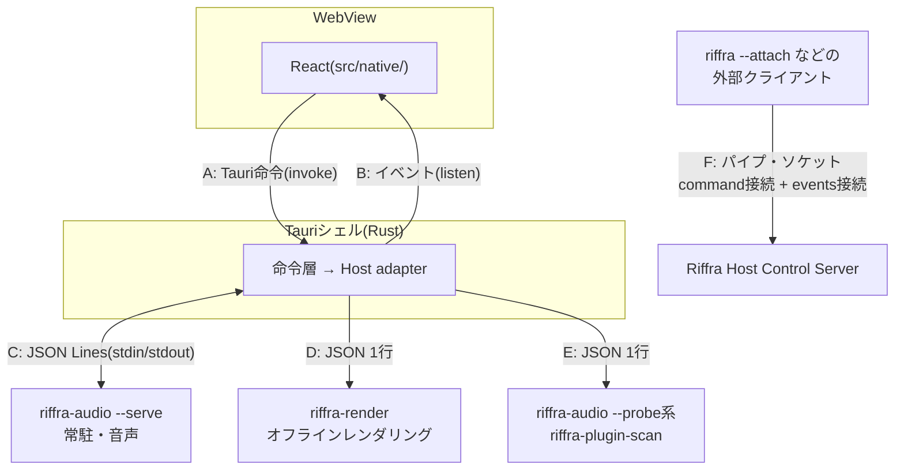

# Riffra IPC 契約

本書はRiffraを構成するプロセス同士、およびHostと外部クライアントの間で交わす契約を定める。各境界で何を運び、どう応答し、どう失敗を伝えるかを扱う。各命令のパラメータと応答の全フィールドはコードを真実源とし、型の同期とフィクスチャの運用は test-strategy.md が担う。システム全体の構造は architecture.md、音声実行の設計は audio-engine.md、エンティティの定義は data-model.md を参照。

## 1. 境界の全体像



| 境界 | 方向                              | 方式                                                  | 用途                                                     |
| ---- | --------------------------------- | ----------------------------------------------------- | -------------------------------------------------------- |
| A    | WebView → Rust                    | `invoke`(Tauri command)                               | すべての操作・編集・照会                                 |
| B    | Rust → WebView                    | Tauri event                                           | 音声状態・メーター・トランスポート・ランタイム回復の通知 |
| C    | Rust ↔ riffra-audio               | 子プロセスの stdin/stdout(JSON Lines)                 | 投影・演奏・録音・MIDI・プレビュー・デバイス制御         |
| D    | Runtime → riffra-render           | 子プロセスの stdin/stdout(JSON 1行)                   | オフラインレンダリング(1要求1プロセス)                   |
| E    | Rust ↔ riffra-audio / plugin-scan | 子プロセスの stdout(JSON 1行)/ 引数                   | デバイス・チャンネル列挙、VST3スキャン                   |
| F    | 外部クライアント ↔ Host           | Windows Named Pipe / Unix Domain Socket(長さ付きJSON) | Hostの正準状態・Runtime操作とHost event購読              |

使い分けの基準は次の通りである。低遅延の音声は C、時間のかかる一括処理は D、列挙は E、WebView操作は A。Fの利用者はHostの外部操作に限る。

子プロセスの stdout はプロトコル専用である。VST3を読み込む起動(`riffra-audio --serve`、`riffra-render`、`riffra-plugin-scan`)では、起動時にプロセス自身の出力をstderrへ切り離し、第三者コードの出力とプロトコル行を分離する。切り離しに失敗した起動は、プラグインを読み込む前にプロセスごと失敗となる。Rust側がプロトコルとして読むのはstdoutだけである。

---

## 2. 境界A: Tauri命令(WebView → Rust)

### 2.1 命令の構成

WebViewからHostへの操作は、すべて `dispatch_control` 1本で送る。Tauri命令として個別に持つのは、Desktop shellが所有する処理である。

| 命令                                                                                | 責務                                                                                 |
| ----------------------------------------------------------------------------------- | ------------------------------------------------------------------------------------ |
| `dispatch_control`                                                                  | Control Command(§2.2)を1件デコードし、接続中のHostで実行して結果の `value` を返す    |
| `get_bootstrap_state`                                                               | CanonicalState・ProjectState・プラグイン一覧・セーフモード・回復候補の初期状態を返す |
| `get_host_connection_state` / `list_local_hosts` / `switch_host` / `reconnect_host` | Hostの選択・切替・再接続                                                             |
| `import_midi_bytes`                                                                 | ドロップされたMIDIバイト列を一時ファイルへ書き出し、`asset.import-midi` で取り込む   |

全命令は `lib.rs` の `invoke_handler` が真実源である。命令は `spawn_blocking` でasyncワーカーから分離して実行する。

### 2.2 Control Command

Hostに頼める操作(Control Command)は、`riffra-runtime` の `api` モジュールにある表(`api/table.rs`)で1回だけ定義する。表の1行は、命令名・Params型・結果型・性質を持つ。Standalone dispatcher、Live Host、CLI、Desktopはすべてこの表から生成された型を使い、命令名の文字列リストを持つ場所は表だけである。

| 性質     | 値                                      | 意味                                                                                                                               |
| -------- | --------------------------------------- | ---------------------------------------------------------------------------------------------------------------------------------- |
| scope    | `host`                                  | `expectedProjectId` を要求しない                                                                                                   |
|          | `project`                               | Active Projectに紐づき、`expectedProjectId` を要求する。Live HostではProjectの書き込み権を取る                                     |
|          | `project(long)`                         | 準備時は確定スナップショットを読み、コミット直前に書き込み権とProject ID・sequenceを照合する長時間処理(VST3のロードを伴う編集など) |
| executor | `canonical`(`read` / `mutation(batch)`) | 正準状態を読む・変える。Standaloneでも実行でき、`batch` の命令は `session.apply` に含められる                                      |
|          | `project`                               | Project containerの一覧・作成・切替・Import / Export                                                                               |
|          | `runtime`                               | Live HostのRuntimeを要する。Standaloneは `runtimeUnavailable` を返す                                                               |

- 要求は最初に `ControlCommand::decode` で型付きの命令になる。未知の命令名、未知のParamsキー、型の不一致は `invalidRequest` となり、`details` にJSON Pointer形式の `path`、配列要素の `index`、小さな値の `value` が付く
- 実行側はexecutorごとの命令を網羅的に `match` する。表に命令を足して実装を書き忘れるとコンパイルエラーになる
- 正準状態を変える命令は `arrangementMutation`(`session.apply` は `batchMutation`)を返す。結果の `type` は `ControlOutput` のvariant名である
- TypeScriptの `ControlCommand`(`{ command, params }` のunion)と `ControlCommandResults`(命令名 → 結果型)はRustから生成する(`npm run gen:types`)

### 2.3 エラー規約

- 失敗は `NativeCommandError` として `code`、`message`、`details` を返す。`message` は表示に専念し、UIの分岐は `code` と `details` で行う
- Native音声エラーは `kind`、`operation`、`details` を保ったまま `NativeAudioError`、Hostの `ProtocolError`、Tauriの `NativeCommandError` へ渡る。境界をまたいでも構造化情報は保たれる
- セーフモード中の音声系・プラグイン系命令は明示エラーを返す(architecture.md「セーフモード」)
- 要求が失敗したとき、応答には現在の状態と失敗の両方が含まれる
- 制作状態を変更する命令の応答に含まれる `CanonicalState` は、その操作自身が確定したスナップショットである。`projectId`、`sequence`、セッション、履歴を一体として返す

```json
{
  "code": "commandFailed",
  "message": "requested audio device was rejected",
  "details": {
    "domain": "nativeAudio",
    "kind": "deviceRejected",
    "operation": "audio.setDriver",
    "details": { "driver": "ASIO", "device": "Unavailable" }
  }
}
```

### 2.4 UI呼び出しの順序

- 確定順序はCoreとHostのProject書き込み権が管理する。フロントエンドは状態を反映する入口で `CanonicalState.projectId` が現在のActive Projectと一致し、sequenceが受け入れ済みの値より新しい場合だけ採用する
- 中間値を捨ててよい連続制御は `dispatchLatestControl` で集約し、最終値のみ送信する。集約された待機者には同一の確定応答を返す
- `dispatchControlOrFallback` は非ネイティブ環境(ブラウザプレビュー・スモークテスト)専用のフォールバックである。ネイティブ実行時は失敗がそのままrejectになる

---

## 3. 境界B: シェル → WebViewイベント

DesktopのActive Projectは初期bootstrapと `ProjectActivationResult` で確定する。`ProjectState` の一覧応答と名称更新イベントは一覧情報を更新し、現在のActive Project IDを維持する。

| イベント                    | ペイロード                | 意味                                                                                                                        |
| --------------------------- | ------------------------- | --------------------------------------------------------------------------------------------------------------------------- |
| `runtime-startup-finished`  | `RuntimeStartupFinished`  | スタートアップ時のランタイム初期化完了(セーフモードでは即通知)                                                              |
| `audio-status`              | `AudioStatus`             | デバイス、コールバック、安全ミュート理由、MIDI、Preview、音声診断の状態                                                     |
| `audio-meters`              | `AudioMeterFrame`         | Project ID、入力・出力ピーク、無効サンプル数、ミュート理由(高頻度)                                                          |
| `transport-status`          | `TransportStatus`         | Transportの状態と再生位置、audio clock、現役グラフのsample rate、適用済み命令番号、録音状態、armed track、instrument faults |
| `runtime-projection-status` | `RuntimeProjectionStatus` | 非同期のランタイム投影状態、現役投影の診断、エラーコード、世代・音声環境revision(queued / preparing / active / failed)      |
| `runtime-restarted`         | `RuntimeRestarted`        | サイドカー再起動(世代番号)。RustがCoreの最新スナップショットを再投影する                                                    |
| `canonical-state-changed`   | `CanonicalState`          | GUI以外のHost操作を含む正準セッション、シーケンス、履歴の変更                                                               |
| `recording-finalized`       | `RecordingFinalized`      | Native処理後の録音Asset登録とArrangement確定の完了結果                                                                      |
| `project-state-changed`     | `ProjectState`            | Projectの作成・改名・Importによる一覧の変更                                                                                 |
| `project-activated`         | `ProjectActivationResult` | Project切替の完了。Active Projectの一覧、CanonicalState、RecoveryStateを一括で通知する                                      |

`audio-meters` はRuntime投影が属する `projectId`、`outputPeakLeft` / `outputPeakRight`、`trackMeters` と `busMeters`(チャンネルID、左右Peak/RMS)を含む。Desktopは現在のActive Projectと `projectId` が一致するframeだけを採用し、Project切替後は旧Projectの値が描画状態へ戻ることがない。高頻度メーターのTrackデータは、低頻度 `audio-status` の到着でも保持される。

Desktopのイベントゲートは現在の接続世代のイベントだけをWebViewへ送る。接続切替の後に旧世代のイベントが届くことはない。フックはこの保証を前提に購読し、コンポーネント破棄後のコールバックだけを自身で止める。購読は `src/native/api/events.ts` のラッパを使い、用途は表示更新に限る。エディタ由来のstate / parameter変更はHost内の正準保存で完結する。

---

## 4. 境界C: 音声サイドカー(riffra-audio)

### 4.1 接続とフレーミング

- 起動: `riffra-audio --serve`。`AudioSupervisor` が起動ごとに世代番号を採番し、`ready` イベント(§4.3)を `SIDECAR_READY_TIMEOUT` まで待つ
- 送受信: JSON Lines(1命令 = stdin 1行、1メッセージ = stdout 1行)。stderrは診断ログ専用である
- 型の真実源: Rustは `crates/riffra-runtime/src/audio/wire/`、C++は `SidecarCommands` / `SidecarMessages`。両者は `contracts/sidecar/` の契約フィクスチャで固定する(test-strategy.md「サイドカー通信契約」)
- 厳格性: 両方向とも契約どおりのデータだけを受け入れる。必須キーの欠落、未知のキー、型の不一致、範囲外の値はすべて契約違反として扱う。値が欠けうるフィールドは常にキーを持ち、欠けていることを `null` で表す

### 4.2 封筒

```jsonc
// Rust → C++: requestId(1以上の整数)と命令本体
{"requestId": 42, "command": {"type": "seekTimeline", "tick": 960}}

// C++ → Rust: kindで応答・失敗・イベントを区別する
{"kind": "response", "requestId": 42, "response": {"type": "transportAccepted", "commandSequence": 42}}
{"kind": "event", "event": {"type": "transportStatus", "appliedCommandSequence": 42, ...}}
{"kind": "error", "requestId": 42, "error": {"kind": "...", "message": "...", "operation": "...", "details": {...}}}
{"kind": "event", "event": {"type": "audioMeters", ...}}
```

- `response` と `error` は必ず `requestId` を持ち、`event` は持たない。Transportの応答はキューへの受け付けを示し、状態は独立した `transportStatus` eventで送る。要求に紐づかない失敗は `fault` イベントで送る
- 1つの要求に対する応答は `response` か `error` のちょうど1回である。C++の `CommandResponder` が要求ごとに1つ作られ、非同期処理へmoveで渡る。応答のないまま破棄されると `noResponse` の `error` を送る
- 命令ごとの応答型は1つに決まる(`SidecarCommand::expected_response`)。`command_bus.rs` は `requestId`(原子カウンタ)で要求を相関し、期待と異なる型の応答はその要求をプロトコルエラーで即座に失敗させ、Hostの状態へ反映しない。中身を持たない完了応答も命令の分類ごとに別の型とし、取り違えを型の不一致として検出する
- 期限: 通常は `COMMAND_ACK_TIMEOUT`、デバイス操作は `AUDIO_DEVICE_COMMAND_TIMEOUT`、`prepareTimelineSnapshot` は `TIMELINE_PREPARE_TIMEOUT` と呼び出し側の残り時間の短い方、`waitForTimelineIdle` は呼び出し側の残り時間を使う。期限切れは失敗報告で確定する

### 4.3 起動とプロトコル版

- サイドカーはデバイスの接続後、最初のメッセージとして `ready` イベント(`protocolVersion` と初期 `AudioStatus`)を1回だけ送る。版は両言語の `SIDECAR_PROTOCOL_VERSION`(`4`)で一致させる
- Rustは `ready` を受けたときだけその世代をreadyにする。版が異なる世代と、`ready` の前に終了したプロセスは起動失敗として扱う
- 版の確認は `ready` に一本化され、個々の命令は版を持たない

### 4.4 命令と応答

| 分類             | 命令                                                                                                                                  | 応答                                                         |
| ---------------- | ------------------------------------------------------------------------------------------------------------------------------------- | ------------------------------------------------------------ |
| 状態照会         | `status`                                                                                                                              | `audioStatus`                                                |
| デバイス・安全   | `recoverAudioDevice`、`setAudioDriver`、`setEmergencyMute`、`setFeedbackProtection`、`setEngineTransitionMute`、`previewMasterGainDb` | `audioStatus`                                                |
| 投影             | `prepareTimelineSnapshot`、`commitTimelineSnapshot`、`discardTimelineSnapshot`、`waitForTimelineIdle`                                 | `timelineAck`(prepare / commit / discard)、`timelineIdleAck` |
| トランスポート   | `setTransportStarting`、`playTimeline`、`pauseTimeline`、`stopTimeline`、`seekTimeline`                                               | `transportAccepted`                                          |
| 録音             | `startArrangeRecording`、`stopArrangeRecording`                                                                                       | `audioStatus`                                                |
| MIDI             | `enableMidiListening`、`disableMidiListening`、`setLiveMidiTarget`                                                                    | `audioStatus`                                                |
|                  | `sendTrackMidi`、`panicTrackMidi`                                                                                                     | `midiAck`                                                    |
| Mixer/プラグイン | `setChannelMix`、`setSendLevel`                                                                                                       | `mixAck`                                                     |
|                  | `setDeviceBypassed`、`setDeviceParameter`、`setPluginState`、`openPluginEditor`                                                       | `deviceAck`                                                  |
|                  | `getDeviceStatus`、`getDeviceParameters`、`getDevicePrograms`                                                                         | `deviceStatus`、`deviceParameters`、`devicePrograms`         |
|                  | `getPluginState`、`setDeviceProgram`                                                                                                  | `pluginState`、`deviceProgramChanged`                        |
| プレビュー       | `previewSample`、`previewInstrument`、`stopPreview`、`stopInstrumentPreview`、`openPluginAudition`                                    | `audioStatus`                                                |
| テイク比較       | `startTakeComparison`、`switchTakeComparisonVariant`、`stopTakeComparison`                                                            | `audioStatus`                                                |

`transportAccepted` は命令の受け付けと `commandSequence` を返し、適用済みの命令番号は `transportStatus.appliedCommandSequence` で分かる。命令の適用順序と実行の設計は audio-engine.md を参照する。

`getDeviceParameterValueForText` はDevice ID、Stable Parameter ID、表示文字列を受け取り、値を変更せずに変換結果を `deviceParameters` へ返す。

`getDeviceParameters` は制御側で最新のPlugin metadataを取得し、`deviceParameters` へ返す。パラメータの識別、表示文字列の扱い、変更の確定条件は audio-engine.md「パラメータと状態」を参照する。

`device.parameter.set` は `value` または `display` の一方だけを受け付ける。表示文字列の変換規則は audio-engine.md「パラメータと状態」を参照する。デバイスの読み書きは、直前の正準変更の投影が音声エンジンへ確定するのを待ってから実行する。

`effect.add` と `instrument.vst3.set` は `pluginPath` または `pluginId` の一方だけを受け付ける。カタログIDからの解決と検証は audio-engine.md「カタログと解決」を参照する。

DesktopのDevicesは既存Control Commandの `device.inspect`、`device.parameter.list/get/set`、`plugin.preset.list/get/set` を使用する。PresetとParameterの編集結果は正準状態へ適用し、詳細を再取得する。Plugin Editorのイベントによる正準値更新も同じ詳細へ反映する。

`setChannelMix` はTrack・BusのGain/Pan、`setSendLevel` は通常SendまたはSidechainSendのLevelを一意なSend IDで現役Graphへ一時適用し、`mixAck` を返す。正準値のコミットは意味しない。Hostの入口は `mixer.channel.preview`、`mixer.send.preview`、`mixer.sidechain.preview` で、Master Gainは `audio.master-gain.preview` を使う。一時値の設計は audio-engine.md「ミキサーの一時値」を参照する。

`device.inspect` の `capabilities.sidechain` は補助入力の利用可否、Mono・Stereoの対応、現在のチャンネル数、利用できない理由を返す。Nativeの `deviceStatus.capabilities.sidechain` を投影するものであり、InstrumentはSidechainの接続先として扱われない。

Effect・Device・Plugin State・Preset・Editor操作は `owner` で所有者を指定する。Trackは `{"kind":"track","id":"..."}`、Group・Returnは `{"kind":"bus","id":"..."}`、Masterは `{"kind":"master"}` とする。Instrument割り当てと演奏はTrack専用である。Editorイベントの `pluginStateChanged`・`pluginParameterChanged` にもProject IDと同じOwner参照を含め、Hostが正準状態へ保存する。

`openPluginAudition` は検証済みのVST3をProjectの外で読み込み、そのエディタを開く。試聴の設計は audio-engine.md「試聴」を参照する。

`prepareTimelineSnapshot` は `TimelineSnapshot` を受け取り、契約違反を `kind: timelineContract` として返し、グラフの準備処理へ進めない。投影の入れ替えの設計は audio-engine.md「グラフの入れ替え」を参照する。

実行グラフのオートメーションの形式と適用は audio-engine.md「オートメーション」を参照する。実行できないレーンは `AudioStatus.diagnostics.automationWarnings` へ返る。

`ExecutionGraph.mixer.sidechainSends` は正準の接続と同じSource Track ID・Target Device ID・Level・Position・Enabledを持ち、未設定時も空配列を送る。Sidechain LevelのLaneは `target.kind: sidechainSendLevel` と `sidechainSendId` で接続を参照する。RealtimeとOfflineで同じ契約を使い、形状は `contracts/execution-graph/` の共有フィクスチャで検証する。

MIDI系の意味づけは次の通りである。

| 命令                               | 意味                                                                                                                                                                                                                               |
| ---------------------------------- | ---------------------------------------------------------------------------------------------------------------------------------------------------------------------------------------------------------------------------------- |
| `setLiveMidiTarget`                | ライブ演奏の対象(Computer Keyboardが有効な間、またはPlay Surfaceを表示中のFocused Instrument Track)をRuntime-only状態に設定する。`trackId: null` で解除する。対象トラックは同一Track Runtimeを使い、トラック間補償遅延のみ迂回する |
| `sendTrackMidi` / `panicTrackMidi` | 要求内のTrack IDへライブMIDIを直接送る                                                                                                                                                                                             |
| `setFeedbackProtection`            | フィードバック保護の切替。解除は `active: false` で行う                                                                                                                                                                            |

### 4.5 エラー

`error` と `fault` は共通の形(`kind`、`message`、`operation`、`details`)を持つ。`kind` は分類、`operation` は失敗した操作、`details` は機械可読の追加情報である。

| `kind`             | 意味                                                                                                                                                                            |
| ------------------ | ------------------------------------------------------------------------------------------------------------------------------------------------------------------------------- |
| `invalidCommand`   | `requestId` は読めたが命令をデコードできない                                                                                                                                    |
| `protocol`         | `requestId` も読めない行を受けた(`fault` で通知)                                                                                                                                |
| `noResponse`       | 命令の処理が応答せずに終わった                                                                                                                                                  |
| `timelineBusy`     | Graphのprepare・commit・discard、投影の置換、またはプラグイン試聴の初期化中で受け付けられない。Track Device命令も処理中の排他操作が終わるまで拒否し、Rustは再試行可能として扱う |
| `timelineContract` | `TimelineSnapshot` の契約違反                                                                                                                                                   |
| その他             | 各領域の失敗(`deviceLost`、`invalidAudioConfiguration` など)                                                                                                                    |

Rustは解釈できない行も捨てることなく扱う。`tracing` に記録し、`AudioStatus.diagnostics.protocolErrors` を加算し、行から `requestId` が読めればその要求を即座に失敗させる。プロセスは継続する。

### 4.6 録音と再生の応答

- `stopArrangeRecording` の応答は停止の受理を表し、適用前の `recording.active: true` を含むことがある。適用後の状態は `audioStatus` イベントで届く
- カウントイン中の停止は録音を取り消す。応答は `recording.cancelled: true` を持ち、確定処理は行わない
- 失敗時はRawあり → `recoverable`、Rawなし → `failed` へ必ず確定してから失敗を通知する
- `processing` 中の新規録音とProject切替は排他する
- Sidechainを使うTrackはDevice別の補助入力をRawと同じキャプチャ窓で保存し、Processed生成に使用する。入力が欠損・不完全な場合、そのTrackのマニフェストは `processedFile` を持たず `processedUnavailableReason` を返す。Rawのみのテイクも正常にAsset登録され、`record.list` の `processedUnavailableReason` で理由を確認できる
- Playの投影準備は非同期に行い、`transportStatus: starting` と `runtime-projection-status` で進捗を通知する。Stopは保留中のPlayを取り消す
- デバイス切替のトランザクションと録音の実行の設計は audio-engine.md を参照する

### 4.7 イベントと出力レーン

C++の出力は3つのレーンに分かれる。`control` は順序を保つバリアで、書き込み時に滞留中の `telemetry` を捨てる。`state` はキーごとに最新の1件へ合流する。`telemetry` は損失を許す。

| type                                            | レーン      | 内容                                                                                                                 |
| ----------------------------------------------- | ----------- | -------------------------------------------------------------------------------------------------------------------- |
| `ready`                                         | `control`   | 起動完了、プロトコル版、初期状態                                                                                     |
| `fault`                                         | `control`   | 要求に紐づかない構造化失敗(§4.5)                                                                                     |
| `recordingComplete`                             | `control`   | NativeのRaw / Processed / MIDI出力の確定結果。`directory`、`success`、失敗時の `message` を持つ                      |
| `audioStatus`                                   | `state`     | 状態・デバイス・録音・MIDI・Preview・ミュート理由・コールバック診断。Rustは `AudioStatus` へ写像して境界Bへ転送する  |
| `pluginStateChanged` / `pluginParameterChanged` | `state`     | エディタ操作等によるプラグイン状態の変化。キーはデバイス(パラメータ変化はデバイスとパラメータ番号)                   |
| `audioMeters`                                   | `telemetry` | ピーク・リミッター診断・無効サンプル・フィードバック検知・Track Meter                                                |
| `transportStatus`                               | `telemetry` | Transportの状態と再生位置、録音状態、適用済み命令番号、現役グラフのinstrument faults。投影診断は別イベントで通知する |

`response` と `error` は `control` レーンを通る。

`transportStatus` は `state`(`stopped` / `starting` / `playing` / `paused` / `faulted`)、`revision`、`timelineTick`、`timelineSample`、`audioClockSample`、`sampleRate`、`appliedCommandSequence`、`recordingPhase`、`recordingStartTick`、`recordingPassOrdinal`、`armedTrackIds`、`instrumentFaults`、`clockGeneration`、`discontinuity` を持つ。Pause中は再生位置を保持し、Resume時にその位置から再開する。`timelineSample` は保留中のSeek先を含み、`revision` と `sampleRate` は現役グラフがない場合に `null` となる。`instrumentFaults` は現役グラフの同じ診断情報を `AudioStatus.diagnostics.instrumentFaults` と共有する。

`audioMeters` の `trackMeters` と `busMeters` はIDと左右Peak/RMS、Masterは左右の最終出力Peakを持つ。RustはRuntime投影の `projectId` を付けて `audio-meters` Host event(`AudioMeterFrame`)へ写像する。

診断値の窓の計算とトラック負荷の詳細はコードとテストを真実源とする。意味と用途は audio-engine.md「メーターと診断」を参照する。

`feedbackSuspected` は `FeedbackProtection` のミュート理由と連動する。ミュート理由と所有者ごとの解除規則は audio-engine.md「安全ミュート」を参照する。未解決クリップと欠落デバイスはNativeのTransport通知に含まれず、現役グラフの `ProjectionDiagnostics` として `RuntimeProjectionStatus.activeDiagnostics` から通知する。

---

## 5. 境界D: オフラインレンダリング(riffra-render)

Hostのrender.start / render.stems JobがWAVごとにriffra-renderを起動し、Realtimeと同じExecution Graphを渡す。GraphはMixerのMaster Effects・Bus・SendとTrackのoutputBusId、解決済みのプラグインパス・保存状態・接続先IDを含む。Nativeは必須フィールドと実行可能な参照を厳密に検証する。Graphの共有フィクスチャは contracts/execution-graph に置く。

| 項目 | 契約                                                                                                                                                                               |
| ---- | ---------------------------------------------------------------------------------------------------------------------------------------------------------------------------------- |
| 起動 | RuntimeBinariesの実行ファイルを使用。配置規則はDesktopとHeadlessで共通                                                                                                             |
| 要求 | stdinへJSON 1行。renderTimelineOffline、protocolVersion: 4、requestにgraph、destination、startTick、endTick、sampleRate、blockSize、tailSeconds、includeEndEvents、normalizeを含む |
| 応答 | 成功はofflineRenderCompleteのframes・sampleRate、失敗はerror。contracts/sidecar/messages/render.*.jsonで形を固定                                                                   |
| 異常 | プロセス異常終了・応答不一致・デコード失敗はJob失敗として扱い、部分的なWAVを破棄する                                                                                               |

Hostが範囲・保存先・Asset登録・Manifestを管理し、Native workerはGraphの実行を担当する。`measurements` と `warnings` の意味、ステムとマスタリングの扱いは audio-engine.md「オフラインレンダリング」を参照する。

---

## 6. 境界E: デバイスプローブとプラグインスキャン

| 起動引数                                              | 応答                                     | 用途                                                         |
| ----------------------------------------------------- | ---------------------------------------- | ------------------------------------------------------------ |
| `riffra-audio --probe`                                | `{"type":"audioDeviceProbe", ...}` を1行 | ASIO/WASAPIのドライバ・デバイスの列挙専用                    |
| `riffra-audio --probe-channels <driver> <device> ...` | `{"type":"deviceChannels", ...}`         | 指定デバイスのチャンネル構成                                 |
| `riffra-plugin-scan <args>`                           | 型タグ付きJSON Lines                     | VST3の列挙・検証(スキャン結果は `ScanReport` としてジョブ化) |

- 直列化: 共有RuntimeのProbe Coordinator経由。待機と実行の双方にタイムアウトを適用する
- 失敗時: 「デバイス状態は変更されていない」ことを明示して失敗する。プローブ専用起動であり、実行中の `--serve` セッションとは独立する
- デバイスプローブの失敗は終了コードとstderrのメッセージで返す。スキャナは結果 `pluginScanResult`、ロード検証 `pluginLoadTestResult`、失敗 `pluginScanError` を型付きJSONで返す。エラーの `details.path` はパスまたは `null` を必ず持つ
- 出力はC++の契約エンコーダから生成し、`contracts/sidecar/messages/probe.*.json` と `pluginScan.*.json` で固定する。Rustは未知・欠落キーを拒否する型でデコードし、nullableのキーも省略を許さない
- 厳格性: スキャン結果はstdout全体を1件のJSONとしてパースし、単一に収まらない出力は候補を隔離して失敗とする。失敗メッセージにはstdout / stderrの抜粋を含める

---

## 7. 境界F: Local ClientとRiffra Host制御

実行モードと状態の所有は architecture.md「実行モード」を参照する。DesktopのHostConnectionManagerも同じControl Command(§2.2)とLocalHostClientを利用するため、EmbeddedとAttachedの制作操作は同じHost command境界を通る。CLIの一回実行と `--interactive` の各行も、送信前に `ControlCommand::decode` で型付きの命令になる。

- DataRootの所有者は1つのHostに限られる。Standalone / `serve` は所有者ありで起動失敗となり、Desktopは接続へ回る
- 公開: 起動中のHostは `<data_root>/control/host.json` とcurrent-user registryへ登録する。Attached CLIの探索先はregistryのみである
- 削除: プロセス不存在か別Host確定のときだけ登録を削除する。一時的な到達不能は一覧から外すだけで、登録は残る
- Helloでは接続の役割を明示する

```json
{"type":"hello","role":"command"}
{"type":"hello","role":"events"}
```

| 種類    | 用途                                                 |
| ------- | ---------------------------------------------------- |
| command | 要求と応答を運ぶ。Desktopは要求ごとに開く            |
| events  | `HostEventFrame { event, payload }` を運ぶ。長く保つ |

- Desktopは要求ごとにcommand接続を開く。長時間要求の実行中もTransport操作や緊急ミュートが並行して処理できる。応答にはタイムアウトを設ける
- イベント配信では、meterやtransport statusなど最新値で足りる通知を上書き集約する。重要通知は必ず配送し、待ち行列が溢れても接続を維持する
- 初期同期はイベント接続の確立後に `host.bootstrap` を取得する。一覧表示は軽量な `host.info` を使い、`host.bootstrap` は接続確定時のみ使う
- Host一覧はRegistryの探索に成功したHostを基準とし、個別の `host.info` 取得に失敗したHostを除外して、他のHostの表示を継続する。Registry探索自体の失敗は一覧全体のエラーとする
- 切替は新接続とbootstrapの準備後に現Hostを交換し、世代を更新して旧Host由来の遅延イベントを破棄する。切替は録音の完了後に行う。終了時はDisconnectedとなり、最終DataRootとinstanceIdを保持して再接続する。Project切替はHost切替と独立し、同一Host内のActive Projectだけを変更する

### 7.1 起動とフレーミング

ワンショットは階層化された引数で1つの操作を実行する。

```bash
riffra --data-root ./data session get
riffra --data-root ./data project list
riffra --data-root ./data project create --name "New Song"
riffra --data-root ./data project open <project-id>
riffra --data-root ./data track add --name Bass --kind instrument
riffra --data-root ./data serve --safe-mode
riffra --attach session get
riffra host list
riffra --attach --host <instance-id> session get
```

- Attachedは候補1件なら自動接続し、複数件なら `--host` によるinstanceId明示を要求する。`host list` はregistry表示だけのローカル操作である
- 対話モードは標準入力1行を1要求とし、標準出力へ1行応答をflushする。空行は読み飛ばす

```bash
riffra --data-root ./data --interactive
riffra --attach --interactive
```

- 要求は `command` と `params` を持ち、`requestId` は応答へそのまま返す。`expectedSequence` 付き要求は正準シーケンス一致時のみ実行する
- Project-bound requestには `expectedProjectId`(`project.list` / `host.bootstrap` で取得)を付ける。Live Hostは `expectedProjectId` を必須とし、欠落・不一致はConflictで返す。Standaloneは自Active Projectで補完する

```json
{
  "requestId": "42",
  "command": "track.add",
  "expectedSequence": 18,
  "expectedProjectId": "550e8400-e29b-41d4-a716-446655440000",
  "params": { "name": "Bass", "kind": "instrument" }
}
```

- AttachedではCLIがstdin各行をフレームへ変換して送る。Hostは1接続内を受信順に処理し、CLIは応答を1行ずつflushする。フレームは8 MiB以下のUTF-8 JSONとする

### 7.2 応答とエラー

- 成功応答は対応する正準シーケンスを含む。`result.type` は命令ごとに表(§2.2)で決まる。`session.get` は `"session"`、正準状態の変更は `"arrangementMutation"`(`canonical` + `projection`、sequence一致)、その他は固有型を使う
- 結果とsequenceは同一 `CanonicalState` スナップショットから一貫して構築する

```json
{
  "requestId": "42",
  "ok": true,
  "sequence": 12,
  "result": { "type": "session", "value": {} }
}
```

| エラーコード         | 発生条件                                                                                       |
| -------------------- | ---------------------------------------------------------------------------------------------- |
| `invalidRequest`     | 入力形式、`params`、型、未知のコマンド、Project-bound requestの `expectedProjectId` 欠落が不正 |
| `commandFailed`      | Core、Host、保存処理が失敗                                                                     |
| `conflict`           | `expectedSequence` または `expectedProjectId` が現在の状態と不一致                             |
| `hostUnavailable`    | Attached CLIがHostへ接続できない                                                               |
| `runtimeUnavailable` | Safe Mode中など、要求されたRuntimeを利用できない                                               |

機械判定はエラーコードで行い、message文字列の解析に頼らない。

```json
{
  "requestId": "42",
  "ok": false,
  "sequence": 20,
  "error": {
    "code": "conflict",
    "message": "canonical state changed",
    "details": { "expectedSequence": 18, "currentSequence": 20 }
  }
}
```

`undo` / `redo` の履歴は、Standaloneが自プロセスのもの、serve / Attachedが接続先Hostのものを共有する。Mixerの一時プレビューはHostの現行sequenceを応答へ含めるが、Canonical sequence、履歴、保存、Projectの世代は進まない。所有者と値の契約はサイドカー命令の節(§4.4)を参照する。

### 7.3 制作操作

CLIは入力形式だけを解釈し、制作規則と正準化は `riffra-core::Application` に委譲する。

Mixerの正準状態は `mixer.get`、Bus一覧は `mixer.bus.list`、Send一覧は `mixer.send.list` で取得する。結果のタグはそれぞれ `mixer`、`mixBuses`、`sends` である。Bus・Sendの追加、更新、削除とTrack主出力先の設定は通常の正準Mutationとして扱い、`arrangementMutation` を返す。`session.apply` にも含められ、作成したBusとSendのIDは `createdEntityIds` の `buses`・`sends` へ記録する。パラメーターの正本は `api/params/mixer.rs`、CLIの操作形式は `agents/skills/riffra-headless/references/commands.md` を参照する。

Sidechain接続は `mixer.sidechain.list` が `sidechainSends` を返す。`mixer.sidechain.add/update/remove` は同じ正準Mutation・Batch契約を使い、新しいIDは `createdEntityIds.sidechainSends` へ記録される。PreviewはRuntime操作であり、Batchには含まれない。

| 分類                   | コマンド                                                                                                                                                                                                                                                                                                                                                                          |
| ---------------------- | --------------------------------------------------------------------------------------------------------------------------------------------------------------------------------------------------------------------------------------------------------------------------------------------------------------------------------------------------------------------------------- |
| Session / History      | `session inspect`、`session get`、`session settings update`、`history get`、`undo`、`redo`                                                                                                                                                                                                                                                                                        |
| Track / Routing        | `track list`、`add`、`update`、`remove`、`duplicate`、`reorder`、`audio-input`、`midi-input`                                                                                                                                                                                                                                                                                      |
| Audio Clip             | `audio-clip list`、`add-asset`、`update`、`move`、`trim`、`split`、`duplicate`、`crossfade`                                                                                                                                                                                                                                                                                       |
| MIDI Clip / Note       | `midi-clip list`、`create`、`add-asset`、`update`、`move`、`trim`、`split`、`duplicate`、`midi-note add/insert/update/update-many/remove/remove-many/clear/quantize/transform/duplicate`                                                                                                                                                                                          |
| Music Operations       | `music.midi-clip.create/resize`、`music.note.list/get/insert/update/remove`、`music.region.list`、`music.region.add`、`music.region.update`、`music.region.remove`、`music.harmony.resolve`、`music.harmony.list`、`music.harmony.insert`、`music.harmony.update`、`music.harmony.remove`、`music.harmony.realize`、`music.phrase.insert`                                         |
| Timeline / Arrangement | `clip remove`、`clip paste`、`marker add/update/remove`、`timebase update`、`loop-range set`、`punch-range set`                                                                                                                                                                                                                                                                   |
| Automation             | `automation get/list`(Canonical read)、`automation set`、`automation clear`                                                                                                                                                                                                                                                                                                       |
| Asset / Project        | `asset import-midi`、`asset preview`、`project list/create/open/rename/export/import`                                                                                                                                                                                                                                                                                             |
| Instrument / Effect    | `plugin catalog list`、`instrument list/apply`、`instrument midi get/set`、`plugin instrument`、`plugin scan/scan-start`、`instrument clear`、`effect add/remove/reorder`、`device bypass`、`device inspect`、`device parameter list/get/set`、`plugin preset list/get/set`、`plugin state get/set`                                                                               |
| Runtime services       | `audio status/diagnostics/probe/channels-probe`、`audio driver get/set`、`audio recover/startup-retry`、`record start/another-take/stop/status/list/rename/archive/promote/tag/delete/duplicates`、`render start/stems/list/export/clean`、`job get/cancel`、`library search/asset-update/related`、`analysis start/measure`、`missing list/relink/disable-plugin/replace-plugin` |

軽量投影の約束: `session inspect`、`track list`、`device inspect`、`music.note.*` は構造把握用であり、本文の取得は `session get`、`plugin.state.get` に委譲する。`device inspect` の応答範囲はmetadataとcapabilityである。

Agent向けCLIの正準Mutation応答は `mutation` receipt(sequence・投影状態・構造IDのみ)へ変換する。Desktop同期の共有プロトコルではCanonical結果を維持する。`plugin state save` は結果をファイルへ保存し、標準出力には保存先のみ返す。

DesktopのTauri command境界とLive HostのControl Serverの機能分担は次の通りである。

| 操作群                                                               | Desktop / serve                   | Standalone                                                                           |
| -------------------------------------------------------------------- | --------------------------------- | ------------------------------------------------------------------------------------ |
| Runtime投影・トランスポート                                          | HostのRuntime                     | `runtimeUnavailable`                                                                 |
| 音声状態・Live MIDI                                                  | HostのAudio Runtime               | `runtimeUnavailable`                                                                 |
| Built-in一覧・プラグイン一覧・VST音源/エフェクト・デバイスパラメータ | HostのInstrument / Plugin Runtime | Built-inの一覧・割り当てはCanonical編集として利用可能、その他は `runtimeUnavailable` |
| 欠落依存                                                             | HostのMissing service             | `runtimeUnavailable`                                                                 |
| 録音                                                                 | HostのRecording                   | `runtimeUnavailable`                                                                 |
| レンダー・ジョブ                                                     | HostのRenderWorker                | `runtimeUnavailable`                                                                 |
| ライブラリ・解析・Asset preview                                      | Hostのshared service              | `runtimeUnavailable`                                                                 |

- エディタ窓・ダイアログ・窓管理はDesktop shellに残る。open / 録音 / プレビュー / スキャン / ライブラリ・解析の実行はHost側を使い、エディタ由来の永続化はHost内coordinatorのcommitで完結する
- `automation.get/clear` は `target` を指定する。`get` は該当Laneを0件または1件の配列で返す。`automation.list` は任意の `owner` でTrack・Bus・Masterの所有するLaneへ絞り込み、省略時は全LaneをID順に返す。読み取りはCanonical sequenceを変更しない
- `automation.set` は `target`、`interpolation`、`points` でLane全体を置き換える。Pointの `value` は数値、またはDevice用の表示文字列を受け付ける。表示文字列はLive Hostで変換し、正準状態には数値だけが保存される。`session.apply` も同じ契約を使い、変換や検証の失敗ではBatch全体をコミットしない
- `render start` は接続先Hostの `RenderWorker` にジョブを開始しIDを返す。部分Renderは音楽座標の `start` / `end` と任意の `trackId` で指定する。状態は `job get`、停止は `job cancel` で行う。Workerの所有者は接続先Hostである
- `render.stems` は `allTracks` または `trackIds` のいずれか一方と共有 `range` を受け取り、接続先Hostの `RenderWorker` で1つの `renderStems` ジョブを開始する。結果には共通の開始・終了Tick、Sample Rate、フレーム数と各TrackのAsset ID・パスを含み、同じ内容を出力ディレクトリの `render.json` に保存する。明示IDが不正な要求はジョブ開始前に拒否する
- `render.start` と `render.stems` は任意の出力先を指定でき、既存ファイルを上書きしない。`render.export` は完了済みRenderを指定先へコピーする
- `analysis.measure` は `renderId` または `paths` と秒数区間 `ranges` を受け取り、既存WAVを測定する `analysisMeasure` Jobを返す。保存済みステムはTrack情報を保持し、結果は要求順に返す。進捗・中止は既存Job契約を用い、正準状態とRender Historyは変更しない。`analysis.start` は波形・RMS等の解析結果を同期的に返す
- `render.list` は管理対象Renderを一覧表示する。`render.clean` はほかから参照されていない管理対象Renderを削除し、外部へExportしたファイルは削除しない
- `instrument.midi.get` はTrack InstrumentのMIDI設定と現在のClip Noteに対する警告を返す。`instrument.midi.set` は設定を保存し、Batch・Undo・Redoで扱える。演奏可能音域外でもMIDI範囲内のNoteは再生し、0〜127を超えるNoteは送信しない
- 結果は全Stemの生成後にだけジョブへ設定される。キャンセルまたは失敗が先に確定した場合、作成済みのファイルとAsset登録を破棄する
- `expectedSequence` は `render.start`、`render.stems`、`undo`、`redo` にも適用する。Conflict時は再Inspectしてやり直す。Revision tokenは同一 `AppCore` の有効期間内でのみ有効である

---

## 8. 権限・ケイパビリティ(`src-tauri/capabilities/default.json`)

メインウィンドウは最小ケイパビリティで構成する。

| 権限                                         | 内容                     |
| -------------------------------------------- | ------------------------ |
| `core:default` / `core:window:allow-destroy` | コア操作とウィンドウ破棄 |
| `dialog:default`                             | ファイルダイアログ       |

更新フローはDesktop所有の `check_for_app_update` / `install_app_update` コマンドで提供する。Windows updaterはインストーラ起動直後にプロセスを終了させるため、`install_app_update` は `on_before_exit` フックでEmbedded Hostの停止を注入する。インストーラがアプリケーションを再起動するため、プロセス再起動の権限は不要である。

---

## 9. NativeApi と境界の対応規則

`src/native/api/` はControl CommandとDesktop固有のTauri命令を、ドメイン用語のcapability interfaceへ写像する。命令名・引数名の知識はcapability層に集約し、各Featureは必要なcapabilityだけに依存する。低レベルAPIのimportはESLintで `src/native/` 配下に限定される。

- Host所有のmethodは `dispatchControl` 系でControl Commandを送る。命令名とParamsは生成された型で検査される。開始時と応答時のconnection generationが一致した応答だけが成功となり、bootstrap・Host切替・Reconnectは現在generationを更新する
- Window・dialog・Host selectorなどDesktop shell所有のmethodは通常の `invoke` を使う。再同期の対象はHost所有のmethodに限られる
- 制作状態を変更するmethodは `CanonicalState` を含む結果を返す。起動時の履歴可否はCoreのHistoryStateで判定する
- `previewTrackMix` と `previewMasterGainDb` はRuntime-onlyの一時プレビューであり、CanonicalStateを返すMutationではない。確定操作はそれぞれ `updateTrack` と `setMasterGainDb` を使い、結果は正準状態と投影結果を含む `ArrangementMutationResult` を返す
- 音声系methodは `AudioStatus` を返し、状態遷移と再試行はAudio設定Featureに集約する
- 失敗は `NativeCommandError` の `code` と `details` で分岐する。Nativeの `kind` / `operation` は `details` 内の `nativeAudio` 情報から参照する
- テストでは `native-api-fake.ts` を注入し、呼び出し記録・設定済み応答と失敗・イベント発火だけを扱う。制作規則・履歴・validationはCoreのテストが担う
