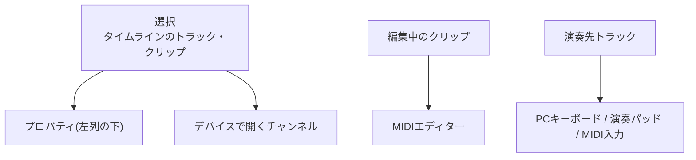

# Riffra 画面設計

この画面で何ができて、どこに何があって、操作すると何が起こるのかを記述する。画面の作り方(コンポーネントや状態管理)はコードが真実源であり、本書では扱わない。制作データの定義は data-model.md、音と遅れの設計は audio-engine.md を参照。

本書では画面の領域を次の名前で呼ぶ。

| 名前         | 場所                                                                                 |
| ------------ | ------------------------------------------------------------------------------------ |
| 上部バー     | 画面いちばん上。プロジェクト、取り消し、再生まわり、音量とメーター、音声の状態       |
| 左列         | 上部バーの下の左側。上からブラウザー、選択中のものの情報                             |
| タイムライン | 中央。トラックとクリップを並べて曲を作る場所                                         |
| 下部の編集面 | タイムラインの下に開く面。MIDIエディター、ミキサー、デバイス、演奏パッドのどれか一つ |

---

## 1. 画面の全体像

```text
┌──────────────────────────────────────────────────────────────────────────────┐
│ 上部バー                                                                      │
│ プロジェクト / 接続 / 取り消し        再生・録音・テンポ        音量 / 音声状態 │
├────────────────────┬─────────────────────────────────────────────────────────┤
│ ブラウザー          │                                                         │
│ 探す・聴く・入れる   │                      タイムライン                        │
├────────────────────┤                                                         │
│ 選択中のもの        ├─────────────────────────────────────────────────────────┤
│ の情報と調整        │ 下部の編集面                                             │
│                    │ MIDIエディター / ミキサー / デバイス / 演奏パッド         │
└────────────────────┴─────────────────────────────────────────────────────────┘
```

四つの領域は切り替えて使うのではなく、同時に開いたまま役割を分担する。タイムラインを再生しながらミディエディターで音を直し、左列で次の素材を探し、演奏先トラックをPCのキーボードで鳴らす、という進め方がそのままできる。

---

## 2. 編集の対象と、演奏の対象は別に持つ

この画面には「今、何を指しているか」を表す状態がいくつかあり、それぞれ独立して動く。混ざらないからこそ、編集しながら演奏できる。



| 状態             | 何を覚えているか                                                                   | 使う場所             |
| ---------------- | ---------------------------------------------------------------------------------- | -------------------- |
| 選択             | タイムラインで選んだトラックやクリップ。ミキサーで選んだグループやマスターも含む   | プロパティ、デバイス |
| 編集中のクリップ | MIDIエディターで開いているクリップ。別のクリップをダブルクリックすればそちらへ移る | MIDIエディター       |
| 演奏先トラック   | キーボードやパッドの音の出る先。楽器トラックを選ぶとそこに移る                     | 演奏入力すべて       |

選択や編集対象を切り替えても、演奏先トラックは勝手に変わらない。クリップを直しながら同じ音源を弾き続けられるのはこのためである。録音のArmも選択や演奏先とは別の状態で、録音するトラックを個別に決める。

演奏先トラックに入った音は、そのトラックに置いた音源とエフェクトを通る。演奏で確認した音は、再生や録音のときと同じ経路である。遅れの出方とその設計は audio-engine.md「音声経路とミックス」を参照。

---

## 3. 上部バー

### 3.1 プロジェクトと接続

左端に、いま開いているプロジェクトと接続先が常に表示される。1行目がプロジェクト名と保存状態、2行目が接続先の名前と状態である。まだ名前のないプロジェクトは `Untitled Project` と出る。内蔵のホストは `Local Desktop` と表示される。

クリックすると一つの画面にプロジェクトと接続先が並ぶ。上から順に、開いているプロジェクトの名前と最終更新、プロジェクトの一覧(名前で絞り込める)、新規作成とImport、いちばん下に接続先の候補と `Connect...` / `Refresh` が並ぶ。

- プロジェクト名はここでその場で書き換えられる。Enterで確定、Escでやめる
- Importだけがファイルダイアログを開き、選んだ `.riffra` を新しいプロジェクトとして取り込む。Exportは指定した場所へ `.riffra` を書き出し、終わると保存先を通知する
- 一覧からプロジェクトを選ぶと直接切り替わる

切り替えのあいだは画面を保ったまま `Opening...` / `Connecting...` を表示し、切り替えに関わる操作を止める。プロジェクトの切り替えに失敗すれば元のプロジェクトが開いたままである。接続が切れたときは最後の接続先が候補として残り、`Reconnect` / `Local Desktop` / `Refresh` で回復できる。

### 3.2 再生と録音

再生まわりの操作はすべてここにある。再生位置、先頭へ戻る、Stop、Play、Pause、Record、ループ、メトロノーム、カウントイン、テンポ、拍子である。キーボードフォーカスがどの領域にあっても、再生位置と録音の状態は同じものである。

| 操作          | 起こること                                                                                  |
| ------------- | ------------------------------------------------------------------------------------------- |
| Play          | 準備ができていればすぐ鳴る。準備のあいだは `Starting` と表示して待つ                        |
| Pause         | 音を短いフェードで止め、再生位置を覚える。録音中のPauseは受け付けず、その理由が表示される   |
| Pause後のPlay | 覚えた位置から続きを鳴らす                                                                  |
| Record        | Armしたトラックへ、カウントインに従って録音を始める。Armがなければ録音対象をArmするよう促す |
| Stop          | 音を止め、自動化で動いていた値を元の値へ戻す。押す前のPlayを取り消す                        |
| メトロノーム  | クリックで入り切りする。右クリックで音色(`Beep` / `Wood`)を選ぶ                             |

再生中は画面が再生位置についていく。スクロールしたあいだは追いかけるのをやめ、再生位置が画面の外に出たら追いかけを再開する。この動きはタイムラインとMIDIエディターで共通である。

素材の試聴(ブラウザー、テイク、ノート、プラグイン)は再生とは別の動きで、画面上で区別がつく。

### 3.3 音声の状態

音声デバイスの状態、音を止めている理由、処理の診断をここで確認できる。デバイス・グラフ・再生は別々の状態として表示される。デバイスが生きていても再生の準備がまだなら `Starting` のままであり、デバイスの復旧と再生の再試行は別の操作である。

---

## 4. 左列

### 4.1 ブラウザー

素材を探して、聴いて、タイムラインへ入れる場所である。検索欄と、Favorites・Collections・Instruments・Effects・Recordingsのフォルダツリーでできている。検索中はフォルダ構造を平らにほどき、一致した項目がどこにあるかを添えて並べる。

項目を選ぶと下端に表示され、Spaceで試聴できる。ダブルクリックかEnterで投入、ドラッグ&ドロップなら投入先を自分で決められる。

| 素材                 | トラックへ入れたとき                   | トラック以外に置いたとき             |
| -------------------- | -------------------------------------- | ------------------------------------ |
| 音源(Instrument)     | 選択トラックの音源を置き換える         | 新しい楽器トラックを作る             |
| エフェクト           | 選択トラックのエフェクトの末尾に追加   | 追加しない                           |
| 録音・音声・MIDI素材 | 同じ種類のトラックへクリップとして置く | 同じ種類のトラックを自動で作って置く |

ダブルクリックとEnterは、選択中のトラックを投入先の候補にする。種類が合わなければトラック以外に置いたときと同じ扱いである。デバイス画面内の追加欄では、いま編集中のチャンネルに合う候補だけが並ぶ。

### 4.2 選択中のものの情報

選択に応じて内容が入れ替わる。上のブラウザーは選択に影響されず、検索の語と表示中の素材を保ち続ける。

| 選択         | 表示するもの                                                                                                                                         |
| ------------ | ---------------------------------------------------------------------------------------------------------------------------------------------------- |
| トラック     | 名前・種別、入力、モニタリング、音量・Panの数値、録音や欠落の状態、音源とエフェクトの件数。音源の差し替えやエフェクト編集はデバイスの担当である      |
| 音声クリップ | 名前、開始と長さ、ゲイン・Pan、フェード、ミュート・ループ。タイムラインで掴んだクリップを数値で仕上げる場所である                                    |
| MIDIクリップ | 名前、開始と長さ、クリップ内の全ノートへの音程・強さ・量子化の一括適用。ノート単位はMIDIエディターである                                             |
| 複数クリップ | 共通できる項目(開始、ミュートなど)を選択全体に反映する。結果がどう広がるかが見える表示を使う                                                         |
| 録音テイク   | 録音候補の比較。Raw / Processedを同じ位置で切り替えて聴き、Useで正式なクリップを更新する。Place copyなら候補を別のクリップとしてタイムラインへ置ける |

---

## 5. タイムライン

### 5.1 ツールバー

タイムライン全体に効く操作を左に、表示の操作を右に並べる。

| 要素                              | すること                                               |
| --------------------------------- | ------------------------------------------------------ |
| Select                            | クリップの選択、移動、端の調整、範囲囲みなど通常の編集 |
| Split                             | 指定位置でクリップを切る                               |
| SNAP                              | 時間操作が吸着する目盛り                               |
| Automation / Mixer / Play Surface | 対応する表示を開閉する                                 |
| Computer Keyboard                 | PCキーボードでの演奏を切り替える                       |
| Bars / Time                       | ルーラーの表示を小節・拍と実時間で切り替える           |
| 拡大 / 縮小                       | 時間方向の表示幅を変える                               |

### 5.2 ルーラー

時間を確認し、範囲を決める場所である。再生位置、選択した範囲、ループ / パンチ、マーカーが同じ目盛りの上に並んで見える。

| すること                      | 起こること                                      |
| ----------------------------- | ----------------------------------------------- |
| クリック                      | 再生位置をそこへ移す                            |
| ドラッグ                      | 範囲を選ぶ                                      |
| マーカーをドラッグ            | マーカーを動かす                                |
| ループ / パンチの端をドラッグ | 範囲を変える                                    |
| 右クリック                    | マーカー追加、選択範囲からのループ / パンチ設定 |

### 5.3 トラック

トラックの左端には、演奏や録音の途中で触るものを集める。

```text
┌──────────────────┬──────────────────────────────────────────────────────┐
│ ● Guitar         │                                                      │
│ AUDIO            │  [ Audio Clip ]        [ Audio Clip ]               │
│ [M] [S] [R] [IN] │                                                      │
│ VOL ─────  PAN   │                                                      │
├──────────────────┼──────────────────────────────────────────────────────┤
│ ● Synth          │      [ MIDI Clip ]                 [ MIDI Clip ]     │
│ INSTRUMENT       │                                                      │
│ [M] [S] [R]      │                                                      │
│ VOL ─────  PAN   │                                                      │
└──────────────────┴──────────────────────────────────────────────────────┘
```

| 項目                | すること                                                 |
| ------------------- | -------------------------------------------------------- |
| 名前                | 選択と名前の変更                                         |
| M / S / R           | ミュート、ソロ、録音のArmを直接切り替える                |
| IN                  | 音声トラックの入力の監視状態を表示・変更                 |
| VOL / PAN           | 演奏中に触る簡易つまみ。数値での仕上げはプロパティで行う |
| Focus(楽器トラック) | 演奏先トラックとして設定する                             |
| 並べ替え / 高さ     | トラックの順番と表示の密度                               |

トラックの右クリックメニューから、デバイスを開く、複製する、削除する(Clipの数を確認してから消える)ができる。入力や名称などの詳しい属性はプロパティ、音源とエフェクトはデバイスが担当する。

### 5.4 クリップ

オーディオクリップとMIDIクリップは同じ手順で扱える。

| すること                | 起こること                           |
| ----------------------- | ------------------------------------ |
| クリック                | 選ぶ                                 |
| Ctrl / Shift + クリック | 選択に足す、外す                     |
| 空白をドラッグ          | 範囲囲みでまとめて選ぶ               |
| ドラッグ                | 時間の位置や、載せるトラックを変える |
| 左右の端をドラッグ      | 長さを変える                         |
| Duplicate / Delete      | 直後に複製する、消す                 |
| Split                   | 再生位置または指定位置で切る         |
| 右クリック              | 結合などの補助操作                   |

オーディオクリップは波形を見せ、素材のどの部分をどの位置に置いたかが一目で分かる。左右の端で長さを、端の内側の取っ手でフェードを調整する。MIDIクリップは中のノートの並びを薄く見せ、ダブルクリックでMIDIエディターを開く。タイムラインで掴むのは置いてある範囲のことで、中の音符はMIDIエディターの担当である。

楽器トラックの空きをダブルクリックすると、空のMIDIクリップが作られてMIDIエディターが開く。位置はSNAPに吸着し、範囲選択があればそれを初めの長さにする。なければクリックした位置から一小節である。

ブラウザーからも、ファイルをそのまま持ち込んでも、タイムラインへ素材を置ける。ドラッグのあいだ、載せられるトラックと位置が見えている。トラックのない空のプロジェクトでは、中央にトラック追加と素材持ち込みの入口を置き、楽器トラックを作ればそのまま音源選びと演奏へ進める。

### 5.5 オートメーション

オートメーションはタイムラインと同じ再生位置、SNAP、拡大率を使う専用のレーンで編集する。トラックの音量・Panやデバイスのパラメータはトラックの直下に開き、グループ・リターン・マスターはトラック群の下の編集域に現れる。ミキサーとデバイスの各所からも、対応するレーンを開ける。

対象の一覧は所有者ごとに並ぶ。プラグインの離散的なパラメータでは選べる値に合わせて段階的な変化だけを選べる。レーンの見出しには変化の仕方、元の値、Read状態を表示する。プラグインが見つからないレーンも消えず、実行の診断が見える。

レーンの上で点を置く、動かす、消す。同じ時刻に置けば既存の点の値を書き換え、最後の点を消すとレーンが外れる。再生中に点を動かしているあいだは音もそれに追従し、ボタンを離した時点で一度だけ確定する。Escapeやキャンセルで元の値へ戻る。AltでSNAPを一時的に外せる。

### 5.6 録音の表示

録音のあいだ、開始した位置から現在までが対象トラックの上に伸びていく。

```text
Instrument Track
│                     REC · PASS 2
│              ├██████████████████│
│              ▲                  ▲
│           record start       current
```

どのトラックが録音対象で、いま何周目で、どこまで進んだかが一目で分かる。終わったクリップとテイクは、選択とプロパティから扱える。

---

## 6. 下部の編集面

タイムラインの下には、いま扱っているものの中身を一段深く見る面が開く。MIDIエディター、ミキサー、デバイス、演奏パッドのどれか一つで、大きさの変更、しまう、大きく開く、閉じるを共通で持つ。

面を切り替えても選択や編集中のクリップは保たれる。MIDIエディターとデバイスは高さを共有し、ミキサーと演奏パッドはそれぞれの高さを覚える。ミキサーや演奏パッドを閉じると、直前に開いていた面へ戻る。

### 6.1 MIDIエディター

クリップの中身を打ち込み、直す場所である。左に鍵盤、中央にノートを置く譜面、下に強さ(ベロシティ)の欄が並び、三つが同じ時間軸を共有する。上のツールバーには編集中のクリップの名前、選択と描画のツール、SNAPとQuantize、Velocity、他クリップの表示(Ghost)が並ぶ。

```text
┌──────────────────────────────────────────────────────────────────────────┐
│ ■ Clip │ [Pointer|Draw] │ SNAP [1/16] [Quantize] │ VEL [─●─] │ [Ghost]  │
├─────────────┬────────────────────────────────────────────────────────────┤
│             │  9.1       9.2       9.3       9.4       10.1            │
│ 鍵盤         ├────────────────────────────────────────────────────────────┤
│             │     ┌──────────┐             ┌──────┐                     │
│ C5          │     │          │             │      │                     │
│             │     └──────────┘     ┌──────────────┐                     │
│ B4          │                      │              │                     │
│             │        ┌───────┐     └──────────────┘                     │
├─────────────┼────────────────────────────────────────────────────────────┤
│ VELOCITY    │        █       █        █        █                         │
└─────────────┴────────────────────────────────────────────────────────────┘
```

**打つ。** Drawツールでドラッグすればノートが続けて置ける。空白のダブルクリックでも一つ置ける。置いた位置はSNAPの目盛りに吸着し、Altを押しているあいだは目盛りを無視して自由に置ける。次に置くノートの長さと強さは、直前に触れたノートから引き継ぐ。

**直す。** ノートを掴んで動かせば、横で時刻、縦で音程が変わる。端を掴めば長さになる。Ctrlを掴みながら動かせば複製される。複数のノートは範囲囲みでまとめて選び、相対的な並びを保ったまま動かせる。Quantizeは選択中のノートをSNAPの目盛りに揃え、選択がなければクリップ全体が対象になる。

| すること              | 起こること             |
| --------------------- | ---------------------- |
| ノートをクリック      | 選ぶ                   |
| Ctrl / Shift + ノート | 選択に足す、外す       |
| 空白をドラッグ        | 範囲囲みで選ぶ         |
| ノートをドラッグ      | 時刻と音程を変える     |
| Ctrl + ドラッグ       | 複製する               |
| 端をドラッグ          | 始まりか終わりを変える |
| Alt + ドラッグ        | SNAPを無視して置く     |
| ダブルクリック        | ノートを作る           |

**選ぶ。** 選択中のノートは矢印キーで時間(`← / →`)、音程(`↑ / ↓`)、オクターブ(Shift + `↑ / ↓`)へ動かせる。`Ctrl+C` / `Ctrl+V` はPlayheadの位置へ貼り、`Ctrl+D` は直後に複製する。

**聴く。** Previewが有効なあいだ、確定したノートは所属トラックの音源で短く鳴る。左の鍵盤を押せばその音が出る。他のクリップが同じタイミングで鳴らす音は背後に薄く見え(Ghost)、位置の合わせに使える。Ghostは選択も編集もできない。表示のON / OFFは切り替えられる。

鍵盤での試聴と、演奏先トラックへの演奏は別物である。前者は「いま編んでいる音の確認」であり、後者は演奏そのものである(§7)。

ルーラーの小節と拍の線はタイムラインと同じ境界に揃う。小節途中から始まるクリップでは、先頭に「9.3」のように拍の位置も添える。時間方向と音程方向の拡大は独立で、Ctrl + ホイールは時間、Alt + ホイールは音程である。

### 6.2 デバイス

選んだチャンネルの信号の道のりを、左から右へ並べて見せる。

```text
[ 音源 / Audio Input ] → [ Effect A ] → [ Effect B ] → [ Add Effect ]
```

楽器トラックは音源から始まり、音声トラックは入力から始まる。グループ・リターン・マスターではエフェクトだけが並ぶ。音源はBuilt-inと検証済みVST3から選び、エフェクトは末尾の `Add Effect` から追加し、左右の移動で順番を変える。各エフェクトにはBypassの状態が見えている。

VST3を選ぶと、そのプラグインが返してくる名前・値・単位・選択肢がそのまま並ぶ。離散的な値は選択欄、それ以外はスライダーである。スライダーを動かしているあいだは画面の下書きとして動き、ボタンを離した時点で一度だけ保存される。各パラメーターのリセットはプラグインの既定値へ戻す。

プラグインがエディタやプリセットを公開していれば、ここから開ける。エディタ側で行った変更はこの画面にも反映される。読み込めないプラグインはRe-scan、Replace、Disableで対処でき、デバイスは消えず、詳細に理由が表示される。

補助入力を持てるエフェクトにはSidechain inputが現れ、送り元トラックごとのLevel、Pre / Post、Enabled、解除、Automationを操作できる。候補には自分のトラックと、すでに接続済みのトラックは出ない。対応していないデバイスと音源にはSidechain編集は現れない。送り元の側から見る場合はミキサーのRoutingである。

デバイスを開いたままPCキーボードで演奏できる。ミキサーでグループやマスターを選んでも演奏先は変わらない。

### 6.3 ミキサー

トラック、グループ、リターンの順に並び、マスターだけが右端に固定される。チャンネルを選ぶとデバイスの編集対象が変わるが、演奏先は変わらない。

```text
┌────────────┐  ┌────────────┐        ┌──────────┐
│ Guitar     │  │ Synth      │        │ MASTER   │
│ FX 2       │  │ FX 1       │  ...   │ FX 3     │
│ → Group 1  │  │ → Master   │        │          │
│ [M][S][R]  │  │ [M][S][R]  │        │ [M]      │
│ AUTO       │  │            │        │ SAFETY   │
│ PAN ──●──  │  │ PAN ───●─  │        │          │
│ █          │  │ █          │        │ █        │
│ █  ──●──   │  │ █  ───●─   │        │ █ ───●─  │
│ █          │  │ █          │        │ █        │
└────────────┘  └────────────┘        └──────────┘
```

各チャンネルには名前、種類、エフェクトの件数、出力先とSendの件数、Pan、左右のメーター、ゲイン、Mute・Solo・Armが見える。自動化のあるつまみにはAUTOが付く。

主出力先とSend件数のボタンからRoutingを開く。Main outputはMasterかGroupを選び、Sendは宛先、Level、Pre / Post、Enabledを編集する。Sidechain欄では、このトラックから送っている接続ごとにLevel、Pre / Post、Enabled、解除、Automationを操作できる。接続の追加は送り先エフェクトのデバイス画面から行い、どちらの画面でも同じ状態が見える。

ゲインやPanを動かしているあいだ、音はすぐにそれへ追従する。ボタンを離した時点で一度だけ確定し、離す前にやめれば元の値へ戻る。確定した値だけが保存と取り消しの対象になる。Automationのボタンからは対応するレーンを開ける。再生中にレーンが値を動かしているあいだ、つまみは静的な値を示す。

メーターは各トラックの処理を通ったあとの音を示す。マスターのSafety欄には、リミッター前のピーク、リミッターの効き、ハードクリップ、ハウリング検知が表示される。

### 6.4 書き出し

マスターのMixdownから、書き出しの設定をして音声を出す。

- ラウドネスの目標、True Peakの上限、Loudness Range、テール、フェードアウトを設定する
- 設定だけ保存するのと、保存してすぐ書き出すのと、二つのボタンがある
- 範囲は全体かループ範囲、対象は全トラックか単一トラックから選ぶ
- ステムは選択トラックごとに同じ時間基準で作られる。非線形なエフェクトでは、ステムの合計が全体のミックスと完全一致しない場合があることを画面が示す

書き出し中は設定が変えられず、進捗とCancel renderが見える。終わると保存先、ピーク、ラウドネス、警告が結果として表示される。測定できない場合はその理由が示される。

---

## 7. 演奏入力

演奏先トラックは二つの入り口から鳴らせる。

**PCキーボード**は表示を持たない入力である。ToolbarのComputer Keyboard(Ctrl+Shift+K)を有効にすると、どこを操作していてもPCのキーが演奏先トラックを鳴らす。A〜Kの行が1オクターブで、Z / Xでオクターブを移る。ドラムパッドモードではキーが各パッドに対応する。

| 規則             | 挙動                                                                                     |
| ---------------- | ---------------------------------------------------------------------------------------- |
| 優先順位         | 修飾キーのない演奏キーはショートカットに勝つ。押しっぱなしの繰り返しも演奏側で消費される |
| 文字入力         | テキスト欄にカーソルがあるあいだは文字入力が勝つ                                         |
| 状態             | モード、オクターブ、強さはトラックごとに覚えられ、演奏パッドと共有される                 |
| 演奏できないとき | 有効化できず、理由がTooltipで出る。演奏できないトラックへ演奏先が移ると入力は外れる      |

**演奏パッド(Play Surface)** は下部の編集面の一つで、画面上のKeyboardとDrum Padsを見せながら演奏できる。Toolbarには演奏先トラックと音源、モード、オクターブ、強さ、PCキーボードの状態が並ぶ。パッドはマウスでも叩け、PCキーボードで鳴らした音も同じパッドが光る。

演奏のあいだ、音の遅れは最小になるよう設計されている(audio-engine.md「遅延補償」)。録音するトラックにはArmを立て、カウントインとメトロノームは上部バーのTransportから行う。録音の進行はタイムライン上に見える(§5.6)。

---

## 8. どの画面でも同じこと

### 8.1 画面は先に動き、離したときに確定する

クリップのドラッグ、ノートの移動、つまみ、オートメーションの点。連続的な操作はすべて、動かしているあいだ画面と音が先に反応し、確定の操作で一度だけ編集が確定する。確定はボタンを離すとき、キー操作の終わり、入力欄からカーソルが外れたときである。Escapeやキャンセルでは元へ戻る。確定した編集だけが、取り消しと保存の対象になる。

### 8.2 状態と困ったとき

Hover、選択、Focus、録音中、警告などの見え方は全体で共通である。Arrangeでは特に、クリップの選択、演奏先トラック、編集中のクリップ、録音、試聴の五つが混同されないように区別できる見た目を使う。

制作が続けられなくなる問題は、その問題の大きさに応じて表示する場所が決まっている。

| 問題                         | 見える場所                      |
| ---------------------------- | ------------------------------- |
| 音声デバイスやエンジンの障害 | 上部バー + 全体への通知         |
| プラグインの欠落             | トラックの状態とデバイス        |
| 音声素材の欠落               | クリップとプロパティ            |
| 再生のずれ                   | タイムラインの状態表示 + 再試行 |
| 一時的な編集の失敗           | Toast                           |

復旧の操作は、問題が出ている場所の近くにある。

### 8.3 ショートカット

ショートカットは、いま編集しているものへ効く。

| 文脈           | 対象     | `Ctrl+A` | `Delete`   | `Ctrl+D`   |
| -------------- | -------- | -------- | ---------- | ---------- |
| タイムライン   | クリップ | 全選択   | 削除       | 直後に複製 |
| MIDIエディター | ノート   | 全選択   | 削除       | 直後に複製 |
| テキスト欄     | 文字列   | 全選択   | 一文字消す | OSの動作   |

| キー                | タイムライン                           |
| ------------------- | -------------------------------------- |
| `Ctrl+C` / `Ctrl+V` | 複写 / 再生位置へ貼り付け              |
| `Ctrl+E`            | 再生位置で分割                         |
| `Delete`            | 選択中のクリップ・マーカー・範囲を消す |
| `M`                 | 再生位置へマーカー                     |
| `Z` / `F`           | 範囲へ拡大 / 全体表示                  |
| `Esc`               | 一時的な選択や表示を閉じる             |

Transportや緊急ミュートのようにアプリ全体に効く操作は、編集文脈に関係なく働く。PCキーボード演奏が有効なあいだは演奏キーがショートカットに勝つ(§7)。

---

## 9. 制作の流れ

| したいこと           | たどる道                                                                                                               |
| -------------------- | ---------------------------------------------------------------------------------------------------------------------- |
| MIDIを打ち込む       | 楽器トラックを作る → 音源を選ぶ → 空白をダブルクリック → MIDIエディターで打ち込む → フレーズを複製 → 再生しながら直す  |
| 録音した音を曲にする | ブラウザーで探して試聴 → タイムラインへドラッグ → 端を調整・フェード → プロパティで数値を仕上げる → 分割と複製で並べる |
| 音作り               | トラックに音源とエフェクト → デバイスを開く → PCキーボードで弾きながら調整 → 順番とBypassで比較                        |
| 弾いて録る           | 演奏先トラックにFocus → Arm → カウントイン → Record → 演奏 → タイムラインで確認 → テイクを比較してUse                  |

どの道を通っても、選び方、動かし方、試聴の仕方、取り消し、失敗の見え方は同じである。この統一が、新しい操作を学ばずに済む理由である。
